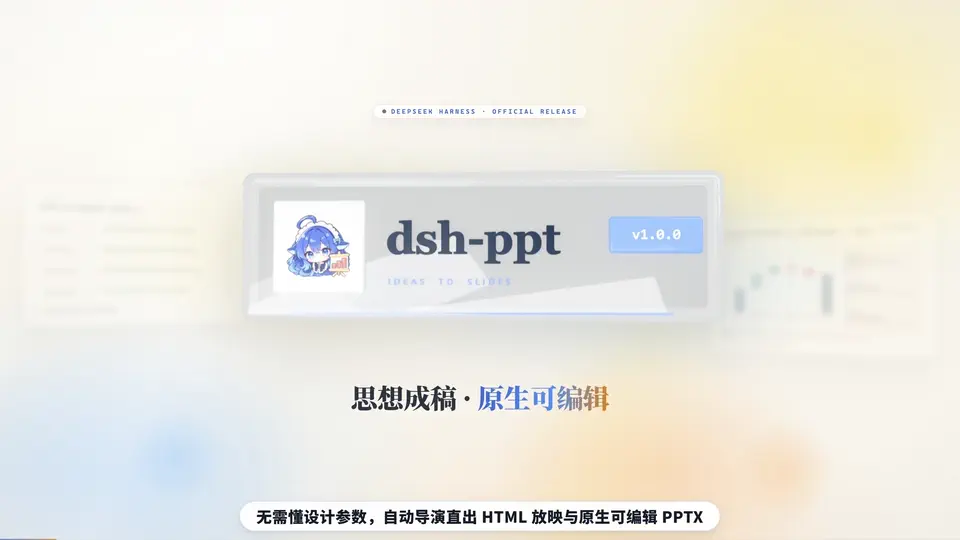
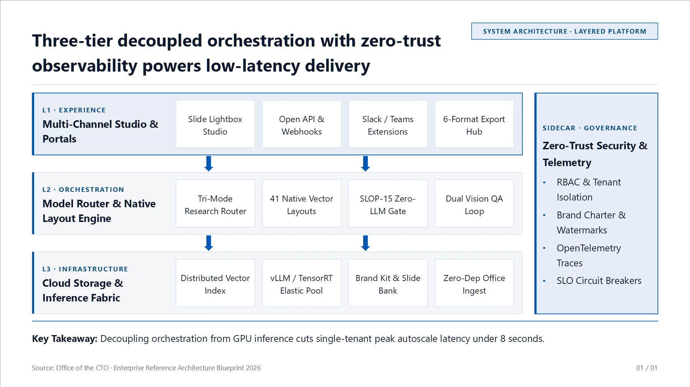
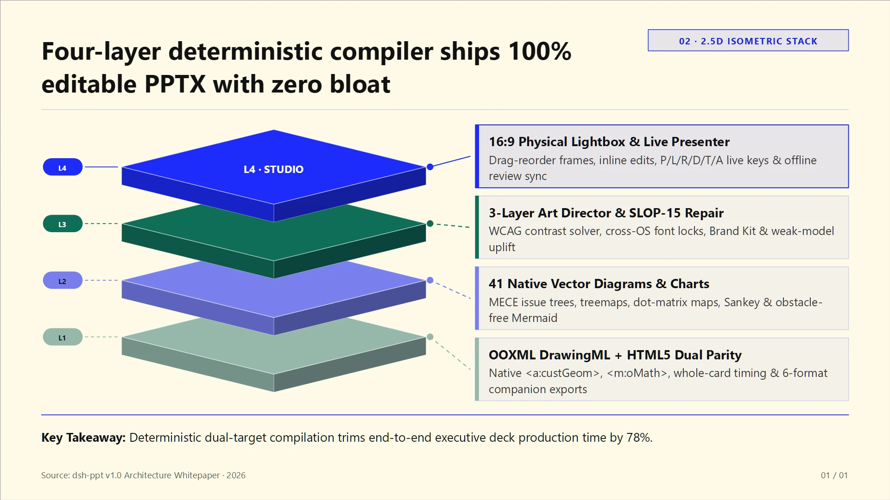
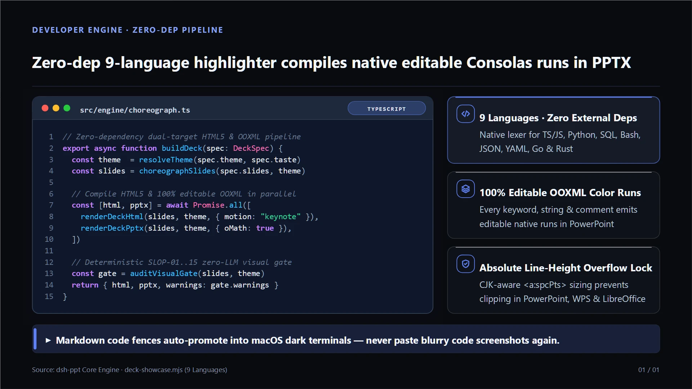
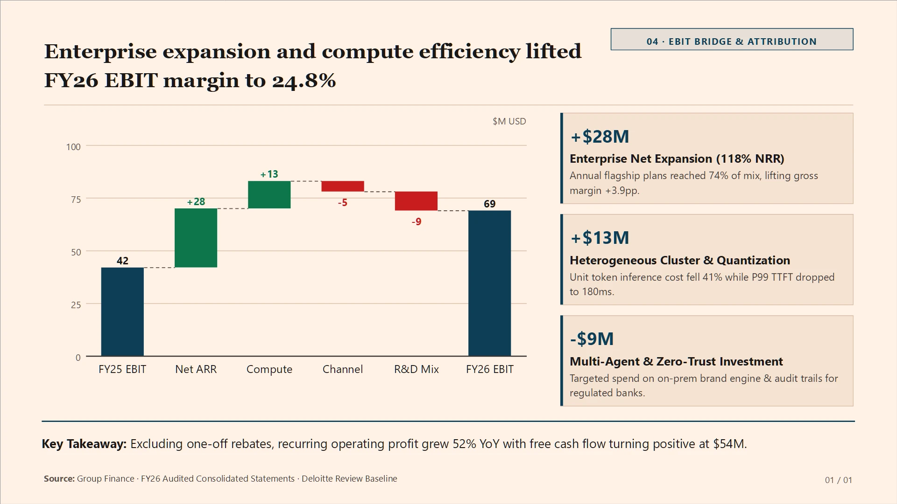
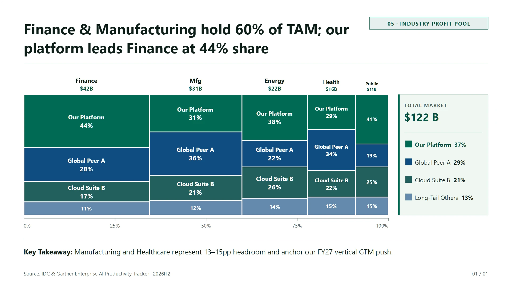
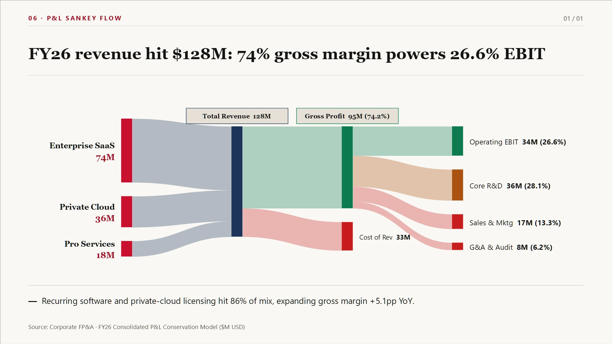
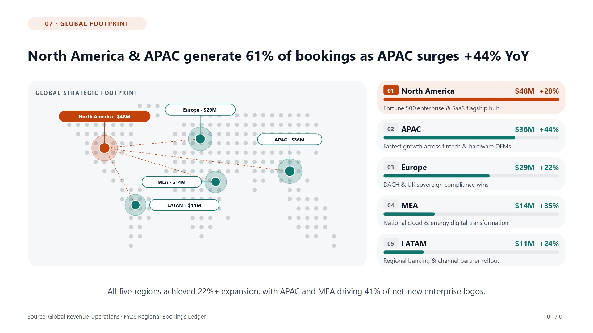
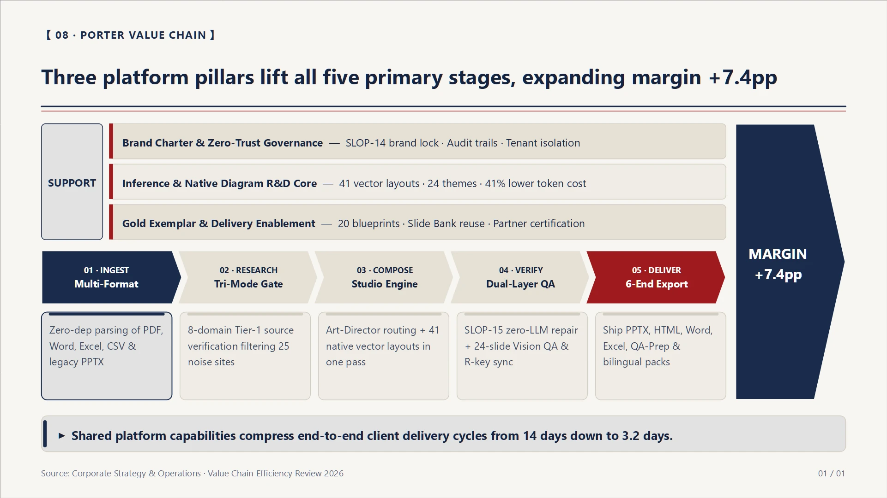
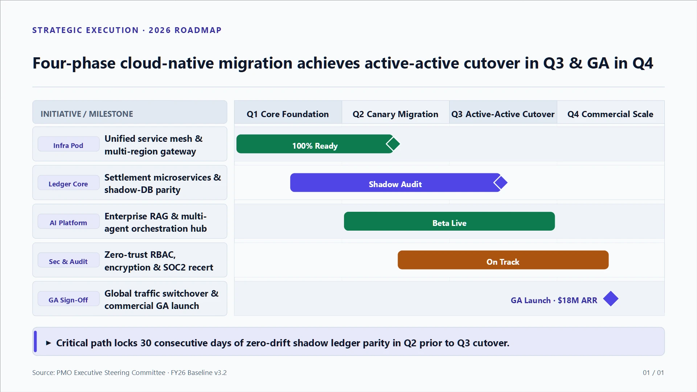

[简体中文](README.md) · **English**

# PPT

> **Turn a prompt, doc, spreadsheet, diagram, or your company's fixed `.pptx` template into standalone HTML slides and 100% native-editable PPTX.**

**Zero rasterized slide screenshots. Zero generic AI boxes.** `dsh-ppt` is a publication-grade presentation engine & illuminated 16:9 Physical Slide Lightbox workbench for DeepSeek Harness (`>=0.2.2-rc.3`) — featuring **Opt-In 1:1 Corporate Template Master Export (preserving editable PowerPoint `slideMaster` / `slideLayout`)**, **41 dual-parity native vector layouts**, **Tri-Mode Authoritative Research (`SLOP-01..15`)**, and **6-format reverse Office delivery**.

[](https://www.npmjs.com/package/dsh-ppt) [](https://www.npmjs.com/package/dsh-ppt) [](https://www.npmjs.com/package/dsh-ppt)

**[Launch Film](#launch-film) · [Features](#features) · [Corporate Masters](#features) · [Style previews](#style-previews) · [Install](#install) · [Workflow](#start-using-it) · [Full guide](https://github.com/STARDUSTLC666/dsh-ppt/blob/master/docs/REFERENCE.en.md)**

<picture>
  <source media="(prefers-color-scheme: dark) and (max-width: 640px)" srcset="https://raw.githubusercontent.com/STARDUSTLC666/dsh-ppt/master/docs/assets/intro/workflow-en-mobile-dark.svg?v=0.36.0">
  <source media="(max-width: 640px)" srcset="https://raw.githubusercontent.com/STARDUSTLC666/dsh-ppt/master/docs/assets/intro/workflow-en-mobile-light.svg?v=0.36.0">
  <source media="(prefers-color-scheme: dark)" srcset="https://raw.githubusercontent.com/STARDUSTLC666/dsh-ppt/master/docs/assets/intro/workflow-en-dark.svg?v=0.36.0">
  
</picture>

## Launch Film

<p align="center">
  <a href="https://github.com/STARDUSTLC666/dsh-ppt/blob/master/assets/promo/dsh-ppt-v1.0.0-promo-1080p.mp4" title="Watch the full 1080p launch film with audio (88.8s)">
    
  </a>
</p>

<p align="center">
  <strong><a href="https://github.com/STARDUSTLC666/dsh-ppt/blob/master/assets/promo/dsh-ppt-v1.0.0-promo-1080p.mp4">▶ Watch Full 1080p Launch Film with Audio (88.8s · MP4)</a></strong>
  &nbsp;·&nbsp;
  <a href="https://raw.githubusercontent.com/STARDUSTLC666/dsh-ppt/master/assets/promo/dsh-ppt-v1.0.0-cover.webp">View Poster Cover</a>
  <br>
  <sub>Highlights the 16:9 Physical Slide Lightbox, instant 24-theme skinning, 41 native vector layouts, HTML↔PPTX dual inspection & 6-format companion exports. BGM: <em>Lucid Dreaming</em> by e s c p (<a href="https://www.free-stock-music.com/">Free Stock Music</a>, <a href="https://creativecommons.org/licenses/by/4.0/">CC BY 4.0</a>, trimmed/edited for runtime)</sub>
</p>

## Features

| Pillar | Capabilities |
| :--- | :--- |
| **1:1 Corporate Template Masters (`NEW`)** | Opt-in 4-role master extraction (**cover / section / content / closing**) from any company `.pptx`, exporting **native editable `slideMaster`/`slideLayout`** (editable in PowerPoint Slide Master View) or lightweight **Isomorphic Overlay**; auto placeholder `safeInsets`, per-role dark/light WCAG polarity, automatic chrome/logo/footer yielding, SHA-256 media dedup & 1:1 HTML/Lightbox parity (default OFF, zero conflict) |
| **41 Native-Editable Layouts** | 100% native OOXML shapes/charts/equations + HTML/SVG parity with bilingual CJK/Western typography tuning: MECE Issue Tree, Treemap, OKR Gauge, Pricing Matrix, World/China Maps, 2.5D Isometric, Magic Quadrant, Radar, obstacle-free Mermaid loops, `<m:oMath>` Formulas & zero-overflow Code windows |
| **Tri-Mode Research Routing** | **Mode A** Direct Build · **Mode B** Zero-Material 8-Domain Research (excluding 25 noise sites) · **Mode C** Hybrid Local Pack + External Benchmarks, guarded by the 9-check `SLOP-13` authority gate |
| **Design System & Self-Repair** | 13 tools · 3-layer built-in Art-Director prompts & golden field cheat-sheet · 24 themes (16 daylight + 8 dark) · 6 master skeletons · 8 Taste Recipes · 20 Gold Exemplars · 61 native vector icons; deterministic `SLOP-01..15` Self-Repair Loop, whole-card PPTX step animations & per-slide transitions |
| **Brand Lock & Slide Bank** | Lock your corporate master, palette, fonts, logo, footer, confidentiality watermark, mandatory closing & source lists in `.dsh-ppt/brand-kit.json` (`SLOP-14`); reuse & merge slides across decks via `.dsh-ppt/slide-bank.json` |
| **Multi-Source Ingest & Exports** | Zero-dep ingestion of `.pdf`/`.docx`/`.xlsx`/`.csv`/`.pptx`/images; reverse exports to `.xlsx`, `.docx`, `.qa-prep.md`, `.memo.md`, One-Pager, Social Carousel, subtitles & lossless `.i18n.json` |
| **Slide Lightbox & Bridges** | Default 16:9 Physical Slide Lightbox + 3-pane Slide Studio (13 refreshed skins × 8 fonts, style-matched default font); integrates with `dsh-cite` & `dsh-remotion`, plus offline `R`-key review feedback loop |

<details>
<summary>Expand: Full 41-layout catalog, multi-audience remix & live presenter shortcuts</summary>

- **Executive & Strategy Diagrams**: MECE `issue-tree`, Squarified `treemap`, OKR `gauge`, 3-tier `pricing`, Magic Quadrant (`quadrant`), Value Chain, SWOT, Harvey balls, Org charts, and TAM.
- **Data Visualization**: World/China Maps (`map`), 2.5D `isometric`, Multi-Series `radar`, `dumbbell`, `heatmap`, Marimekko, Sankey, booktabs tables, and 13 publication chart types.
- **Product & Engineering Blocks**: Device `mockup`, 9-language `code` terminals, native `<m:oMath>` equations, Mermaid connectors, Gantt charts, and Architecture diagrams.
- **Multi-Audience Remix (`remixPreset`)**: Compress into `exec-5min` (6p), `board-brief` (8p), or `sales-pitch` (7p) copies with folded notes archived losslessly, plus `4:5` / `1:1` Social Carousel HTML.
- **HTML Presenter Shortcuts**: `P` Presenter Console · `L` Laser Pointer · `R` Offline Review (`review-feedback.json`) · `D` Pen · `T` Q&A Timer · `A` Auto-Captions · `Ctrl/Cmd+K` Search.
- **Template Absorption & Optional Audits**: Batch-absorb local `.pptx` decks via `ppt_absorb`, plus opt-in live data lineage, 24-slide Vision QA, and rehearsal coaching.

</details>

## Style previews

All 9 high-density structured slides below are LibreOffice-rendered directly from **100% native editable `.pptx`** files built by `dsh-ppt` (`missingFonts: []`), spanning 9 native layouts, 9 themes, and 5 master chrome skeletons. Select any image to enlarge.

<table>
<tr>
  <th>3-Tier System Architecture + Sidecar</th>
  <th>2.5D Isometric 4-Layer Stack</th>
  <th>Dark Syntax-Highlighted Code Split</th>
</tr>
<tr>
  <td width="33%"><a href="https://raw.githubusercontent.com/STARDUSTLC666/dsh-ppt/master/assets/gallery/v100-arch-layered-en.webp"></a></td>
  <td width="33%"><a href="https://raw.githubusercontent.com/STARDUSTLC666/dsh-ppt/master/assets/gallery/v100-iso-stack-en.webp"></a></td>
  <td width="33%"><a href="https://raw.githubusercontent.com/STARDUSTLC666/dsh-ppt/master/assets/gallery/v100-code-dark-en.webp"></a></td>
</tr>
<tr>
  <th>FT Salmon EBIT Waterfall + Callouts</th>
  <th>Variable-Width Market Map (Marimekko)</th>
  <th>Multi-Layer P&amp;L Sankey Flow</th>
</tr>
<tr>
  <td width="33%"><a href="https://raw.githubusercontent.com/STARDUSTLC666/dsh-ppt/master/assets/gallery/v100-waterfall-ft-en.webp"></a></td>
  <td width="33%"><a href="https://raw.githubusercontent.com/STARDUSTLC666/dsh-ppt/master/assets/gallery/v100-marimekko-en.webp"></a></td>
  <td width="33%"><a href="https://raw.githubusercontent.com/STARDUSTLC666/dsh-ppt/master/assets/gallery/v100-sankey-en.webp"></a></td>
</tr>
<tr>
  <th>Global Strategic Dot-Matrix Map</th>
  <th>Porter Value Chain + Margin Wedge</th>
  <th>4-Quarter Multi-Track Gantt Roadmap</th>
</tr>
<tr>
  <td width="33%"><a href="https://raw.githubusercontent.com/STARDUSTLC666/dsh-ppt/master/assets/gallery/v100-geo-map-en.webp"></a></td>
  <td width="33%"><a href="https://raw.githubusercontent.com/STARDUSTLC666/dsh-ppt/master/assets/gallery/v100-value-chain-en.webp"></a></td>
  <td width="33%"><a href="https://raw.githubusercontent.com/STARDUSTLC666/dsh-ppt/master/assets/gallery/v100-gantt-roadmap-en.webp"></a></td>
</tr>
</table>

<details>
<summary>View the workbench (16:9 Physical Slide Lightbox & Slide Studio)</summary>


Actual interface with controlled validation data; rendered from native `.pptx` sample outputs.

</details>

## Install

Open **Plugins** in the DSH desktop app and install `dsh-ppt`, or use the CLI:

```bash
dsh plugin --profile desktop add dsh-ppt
```

For the web profile, replace `desktop` with `web` and restart DSH. Requires DSH `>=0.2.2-rc.3`.

## Start using it

1. **Draft in seconds**: Open **Presentations** in the sidebar (click `? Guide` for a 4-step tour), launch the Flagship Demo, pick from 20 blueprints, drop Office/legacy `.pptx` files, or hand docs and Mermaid diagrams to chat.
2. **Slide Lightbox → Slide Studio**: Open in the 16:9 **Lightbox** (drag or `←/→` to reorder, duplicate, or insert); click any frame for **Slide Studio**, double-click to edit inline, switch across 41 layouts, and press `Ctrl/⌘+S` to sync HTML & PPTX.
3. **Apply company templates & modernize**: Upload a corporate `.pptx` in **New presentation** or **Style Studio** and enable **Corporate Template Master** to export native editable `slideMaster` slides and lock it into `.dsh-ppt/brand-kit.json`; also refurbish legacy `.pptx` files or round-trip PowerPoint/WPS edits with undo history.
4. **Inspect & deliver everywhere**: Toggle side-by-side HTML & PPTX inspection or optional AI coaching/rehearsal, then export PPTX, One-Pager, Excel/Word/QA-Prep, Social Carousel, or Remotion storyboard packs.

### Ready-to-copy prompts

- **Use your company's fixed `.pptx` template (1:1 master)**: `Keep the exact native slideMaster and layout backgrounds from company-template.pptx (useTemplateMaster: true), turn this briefing into a 10-slide executive deck, and lock it to our workspace brand kit.`
- **Quarterly / OKR review**: `Turn these notes into a Quarterly OKR review deck with action titles, KPI cards, value-chain chevrons, and issue-action comparisons (HTML + editable PPTX).`
- **Product pitch**: `Build a 10-slide daylight investor memo deck from this proposal with TAM market sizing, a Harvey-ball competitor matrix, and a Gantt delivery roadmap.`

## Before you start

- Finished decks download directly; AI review, rehearsal, and 24-slide visual repair are strictly opt-in.
- CLI and skill error messages are in Chinese.
- Full configuration, tools, and troubleshooting: [full reference](https://github.com/STARDUSTLC666/dsh-ppt/blob/master/docs/REFERENCE.en.md).

## Plugin updates

Check updates at the bottom of the workbench or native plugin details. Automatic checks are on by default; **automatic installation is off**. Suite-managed components update with their bundle.

## Documentation & feedback

- [Full usage, configuration and limits](https://github.com/STARDUSTLC666/dsh-ppt/blob/master/docs/REFERENCE.en.md) · [Release notes](https://github.com/STARDUSTLC666/dsh-ppt/blob/master/CHANGELOG.md) · [Validation history](https://github.com/STARDUSTLC666/dsh-ppt/blob/master/docs/VALIDATION.md)
- Stars, [Issues](https://github.com/STARDUSTLC666/dsh-ppt/issues), and [PRs](https://github.com/STARDUSTLC666/dsh-ppt/pulls) are welcome (include versions and steps, and strip credentials).

## License

[MIT](https://github.com/STARDUSTLC666/dsh-ppt/blob/master/LICENSE)

<a id="what-it-does"></a>
<a id="requirements-and-configuration"></a>
