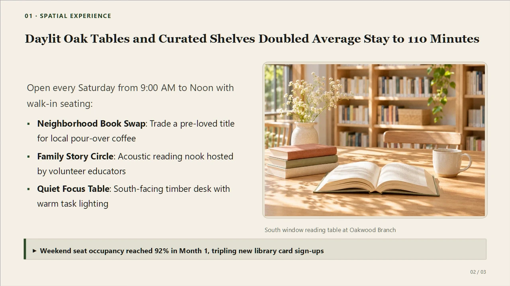
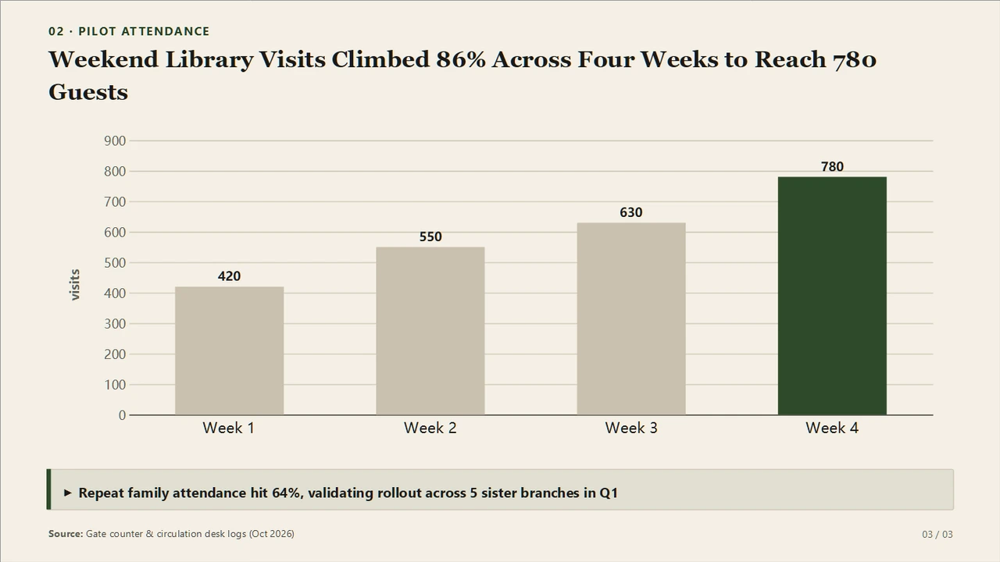

[简体中文](README.md) · **English**

# PPT

**Turn source material into publication-grade, deliverable presentations in DeepSeek Harness—HTML playback, editable PPTX, and project bundles—in a 5-theme light workbench.**

[](https://www.npmjs.com/package/dsh-ppt) [](https://www.npmjs.com/package/dsh-ppt) [](https://www.npmjs.com/package/dsh-ppt)

**[Install](#install) · [Workflow](#start-using-it) · [Full guide](https://github.com/STARDUSTLC666/dsh-ppt/blob/master/docs/REFERENCE.en.md)**

<picture>
  <source media="(prefers-color-scheme: dark) and (max-width: 640px)" srcset="https://raw.githubusercontent.com/STARDUSTLC666/dsh-ppt/master/docs/assets/intro/workflow-en-mobile-dark.svg">
  <source media="(max-width: 640px)" srcset="https://raw.githubusercontent.com/STARDUSTLC666/dsh-ppt/master/docs/assets/intro/workflow-en-mobile-light.svg">
  <source media="(prefers-color-scheme: dark)" srcset="https://raw.githubusercontent.com/STARDUSTLC666/dsh-ppt/master/docs/assets/intro/workflow-en-dark.svg">
  
</picture>

## Features

- **Zero-taste-burden Auto-Director**: Automatically selects from **18 curated themes** (12 projector-safe daylight + 6 stage dark), **6 distinct Master Chrome Skeletons** (McKinsey Consulting Classic, Apple Keynote Spatial, Editorial Folio, SaaS Bento, Academic Beamer, Gov Ceremonial), **16 industry blueprints**, and **24 native editable layouts & pro diagrams** (Bento cards, KPI hero metrics, 2×2 matrices, comparisons, process/flywheel flows, Gantt roadmaps, layered architecture diagrams, Harvey-ball competitor matrices, concentric TAM/SAM/SOM, org/team charts, academic 3-line tables, and 13 publication-grade chart types including vector waterfall bridges).
- **Deep Reference `.pptx` Skeleton Absorption**: Combines built-in design systems with **Deep `.pptx` Absorption** (`ppt_absorb`, `referencePptx` with `cloneStructure: true`, or drag-and-drop in Style Studio) — resolving OOXML color transforms, CJK/Latin fonts, master logos, chrome geometry (`extractedSkeleton` / `recommendedChrome`), and slide-by-slide `slideSkeleton` sequences with automatic WCAG ≥4.5:1 contrast sanitization.
- **Interactive Workbench & Style Studio**: Adapted for DeepSeek Harness `>=0.2.2-rc.3` with 5 switchable studio UI themes (Native Airy / Warm Cream / Claude Warmth / Bright 8-Bit / Airy Mint); switch 18 deck themes, 6 master chrome skeletons, and 24 slide archetypes in one click; edit Gantt timelines, Harvey-ball matrices, structured cards, tables, and images; compare HTML and rendered PPTX side-by-side; and undo up to 20 revisions.
- **Optional verification & coaching**: Traceable numbers with live what-if sliders across diagrams and tables, 24-slide two-tier Vision QA (12 lossless formatting actions + full-width before/after canvas diff), and executive storyline coaching / defense rehearsal.

## Style previews

Rendered from PPTX files made with dsh-ppt. Select an image to enlarge it.

<table>
<tr>
  <th>Editorial forest cover</th>
  <th>Framed photo & takeaway</th>
  <th>Focal-highlight chart</th>
</tr>
<tr>
  <td width="33%"><a href="https://raw.githubusercontent.com/STARDUSTLC666/dsh-ppt/master/assets/gallery/editorial-en.webp"></a></td>
  <td width="33%"><a href="https://raw.githubusercontent.com/STARDUSTLC666/dsh-ppt/master/assets/gallery/reading-corner-en.webp"></a></td>
  <td width="33%"><a href="https://raw.githubusercontent.com/STARDUSTLC666/dsh-ppt/master/assets/gallery/visits-chart-en.webp"></a></td>
</tr>
</table>

The photo was generated for the example, and the chart uses sample data.

<details>
<summary>View the workbench</summary>


Actual interface with controlled validation data; the PPTX image is a rendered sample when shown.

</details>

## Install

Open **Plugins** in the DSH desktop app and install `dsh-ppt`. If the CLI is available:

```bash
dsh plugin --profile desktop add dsh-ppt
```

For the web profile, replace `desktop` with `web`. Restart that DSH profile after installation. The package’s DSH requirement is `>=0.2.2-rc.3`.

## Start using it

1. Provide material, purpose, audience, or a reference `.pptx` in the target workspace — no manual design tuning needed; Scenario Auto-Director selects a tailored daylight/dark theme and varied slide layouts automatically.
2. Open Presentations in the sidebar and search for or select the generated project.
3. Switch 24 slide archetypes, edit Gantt timelines, Harvey matrices, structured cards/tables/images in **Edit content**, or restyle the whole deck across 18 themes & 6 master skeletons and absorb a corporate `.pptx` in **Style Studio**; render the current PPTX for side-by-side HTML ↔ PPTX comparison when needed.
4. Explicitly start optional AI storyline review, defense rehearsal, or 24-slide visual repair when needed; direct download does not require them.
5. Deliver the share bundle or retain editability with the project bundle; check the result in the target browser or Office application.

Example request:

> Create an executive strategy deck from this material with HTML, editable PPTX and a project bundle — automatically match a clean daylight theme and varied KPI/card/chart layouts.

## Before you start

Download the finished deck directly; AI review, rehearsal and visual repair are optional. Office edits do not sync back into the project.

Configuration, detailed tools and troubleshooting: [full reference](https://github.com/STARDUSTLC666/dsh-ppt/blob/master/docs/REFERENCE.en.md).

## Plugin updates

Check updates at the bottom of the workbench or native plugin details. Automatic checks are on by default; **automatic installation is off**. You choose whether to install and when to restart. Suite-managed components update with their bundle. [Update behavior](https://github.com/STARDUSTLC666/dsh-ppt/blob/master/docs/REFERENCE.en.md).

## Documentation

- [Full usage, configuration and limits](https://github.com/STARDUSTLC666/dsh-ppt/blob/master/docs/REFERENCE.en.md)
- [Release notes](https://github.com/STARDUSTLC666/dsh-ppt/blob/master/CHANGELOG.md)
- [Validation scope and history](https://github.com/STARDUSTLC666/dsh-ppt/blob/master/docs/VALIDATION.md)

## Feedback and contributions

If the plugin helps, a Star makes it easier for others to discover. Report problems or suggest improvements in [Issues](https://github.com/STARDUSTLC666/dsh-ppt/issues); code and documentation [PRs](https://github.com/STARDUSTLC666/dsh-ppt/pulls) are welcome. Include versions and reproduction steps, and remove credentials from reports.

## License

[MIT](https://github.com/STARDUSTLC666/dsh-ppt/blob/master/LICENSE)

<a id="what-it-does"></a>
<a id="requirements-and-configuration"></a>
