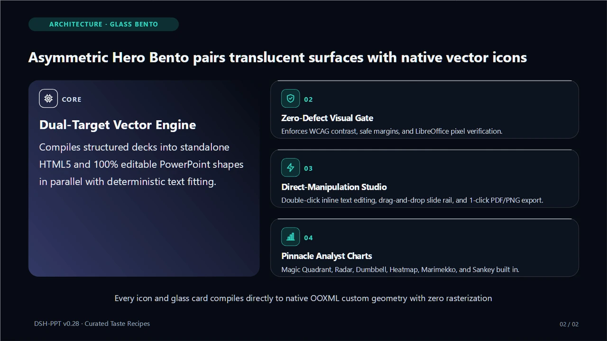
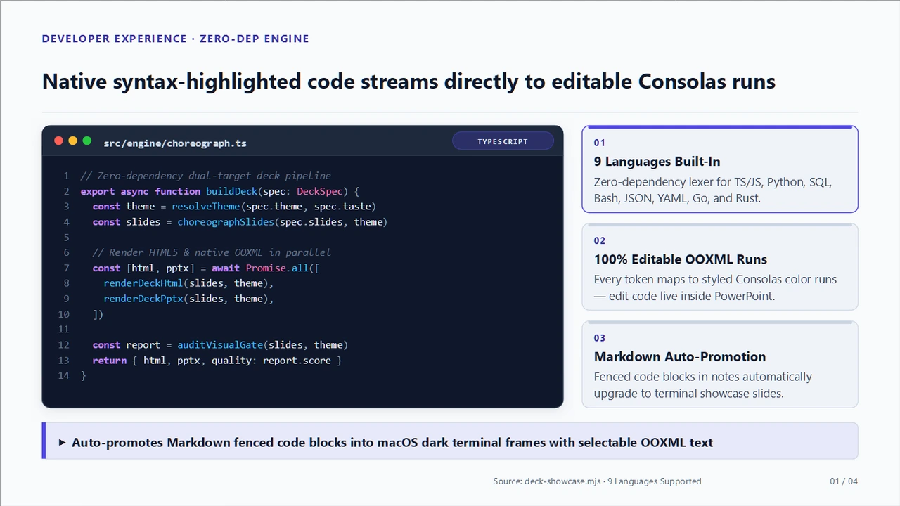
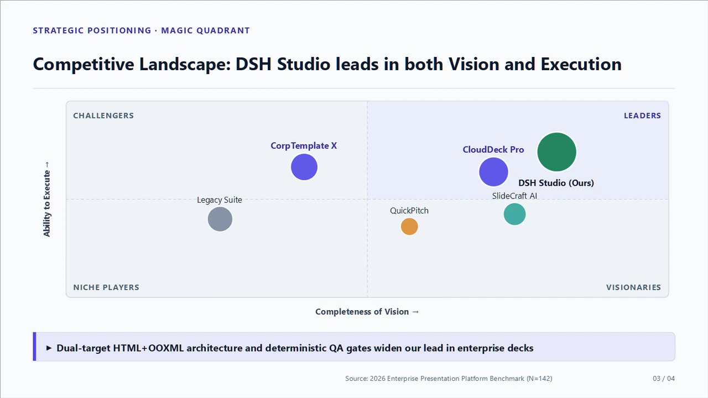
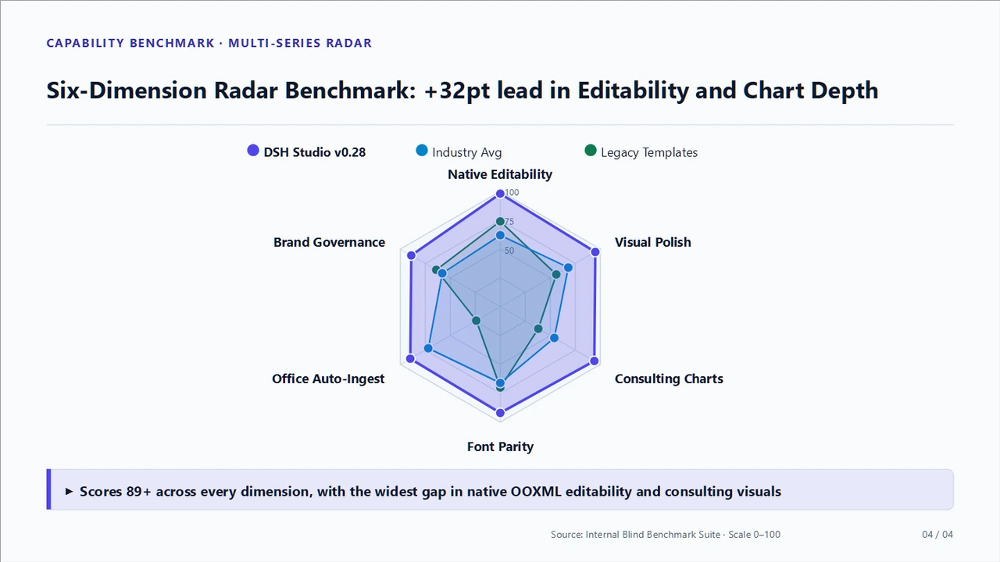

[简体中文](README.md) · **English**

# PPT

> **Turn docs, spreadsheets, diagrams, or legacy decks into standalone HTML slides and 100% editable PPTX.**

Publication-grade presentation engine & illuminated 16:9 Physical Slide Lightbox workbench for DeepSeek Harness (`>=0.2.2-rc.3`), featuring Tri-Mode Research Routing, 41 dual-parity native layouts, Enterprise Brand Kit Lock, and reverse Office exports.

[](https://www.npmjs.com/package/dsh-ppt) [](https://www.npmjs.com/package/dsh-ppt) [](https://www.npmjs.com/package/dsh-ppt)

**[Features](#features) · [Style previews](#style-previews) · [Install](#install) · [Workflow](#start-using-it) · [Full guide](https://github.com/STARDUSTLC666/dsh-ppt/blob/master/docs/REFERENCE.en.md)**

<picture>
  <source media="(prefers-color-scheme: dark) and (max-width: 640px)" srcset="https://raw.githubusercontent.com/STARDUSTLC666/dsh-ppt/master/docs/assets/intro/workflow-en-mobile-dark.svg?v=0.36.0">
  <source media="(max-width: 640px)" srcset="https://raw.githubusercontent.com/STARDUSTLC666/dsh-ppt/master/docs/assets/intro/workflow-en-mobile-light.svg?v=0.36.0">
  <source media="(prefers-color-scheme: dark)" srcset="https://raw.githubusercontent.com/STARDUSTLC666/dsh-ppt/master/docs/assets/intro/workflow-en-dark.svg?v=0.36.0">
  
</picture>

## Features

| Pillar | Capabilities |
| :--- | :--- |
| **Tri-Mode Research Routing** | **Mode A** Direct Build · **Mode B** Zero-Material 8-Domain Research (excluding 25 noise sites) · **Mode C** Hybrid Local Pack + External Benchmarks, guarded by the 9-check `SLOP-13` authority gate |
| **41 Native-Editable Layouts** | 100% HTML/SVG + OOXML parity with zero runtime bloat: MECE Issue Tree, Treemap, OKR Gauge, Pricing Matrix, World/China Maps, 2.5D Isometric, Magic Quadrant, Radar, Mermaid, Formulas & Code |
| **Design System & Self-Repair** | 13 tools · 24 themes (16 daylight + 8 dark) · 6 master skeletons · 8 Taste Recipes · 20 Gold Exemplars · 61 native vector icons; deterministic `SLOP-01..14` Zero-LLM Self-Repair Loop before commit |
| **Brand Lock & Slide Bank** | Lock palette, fonts, logo, footer, confidentiality watermark & source lists in `.dsh-ppt/brand-kit.json` (`SLOP-14`); reuse & merge slides across decks via `.dsh-ppt/slide-bank.json` |
| **Multi-Source Ingest & Exports** | Zero-dep ingestion of `.pdf`/`.docx`/`.xlsx`/`.csv`/`.pptx`/images; reverse exports to `.xlsx`, `.docx`, `.qa-prep.md`, `.memo.md`, One-Pager, Social Carousel, subtitles & lossless `.i18n.json` |
| **Slide Lightbox & Bridges** | Default 16:9 Physical Slide Lightbox + Slide Studio (13 styles × 8 fonts); integrates with `dsh-cite` & `dsh-remotion`, plus offline `R`-key review feedback loop |

<details>
<summary>Expand: Full 41-layout catalog, multi-audience remix & live presenter shortcuts</summary>

- **Executive & Strategy Diagrams**: MECE `issue-tree`, Squarified `treemap`, OKR `gauge`, 3-tier `pricing`, Magic Quadrant (`quadrant`), Value Chain, SWOT, Harvey balls, Org charts, and TAM.
- **Data Visualization**: World/China Maps (`map`), 2.5D `isometric`, Multi-Series `radar`, `dumbbell`, `heatmap`, Marimekko, Sankey, booktabs tables, and 13 publication chart types.
- **Product & Engineering Blocks**: Device `mockup`, 9-language `code` terminals, native `<m:oMath>` equations, Mermaid connectors, Gantt charts, and Architecture diagrams.
- **Multi-Audience Remix (`remixPreset`)**: Compress into `exec-5min` (6p), `board-brief` (8p), or `sales-pitch` (7p) copies with folded notes archived losslessly, plus `4:5` / `1:1` Social Carousel HTML.
- **HTML Presenter Shortcuts**: `P` Presenter Console · `L` Laser Pointer · `R` Offline Review (`review-feedback.json`) · `D` Pen · `T` Q&A Timer · `A` Auto-Captions · `Ctrl/Cmd+K` Search.
- **Template Absorption & Optional Audits**: Batch-absorb local `.pptx` decks via `ppt_absorb`, plus opt-in live data lineage, 24-slide Vision QA, and rehearsal coaching.

</details>

## Style previews

Every preview below is LibreOffice-rendered directly from **100% native editable `.pptx`** files built by `dsh-ppt` (`missingFonts: []`). Select any image to enlarge.

<table>
<tr>
  <th>Keynote Glow Poster Cover</th>
  <th>Glass Bento + Native Vector Icons</th>
  <th>Syntax-Highlighted Code Terminal</th>
</tr>
<tr>
  <td width="33%"><a href="https://raw.githubusercontent.com/STARDUSTLC666/dsh-ppt/master/assets/gallery/v28-cover-keynote-en.webp"></a></td>
  <td width="33%"><a href="https://raw.githubusercontent.com/STARDUSTLC666/dsh-ppt/master/assets/gallery/v28-bento-glass-en.webp"></a></td>
  <td width="33%"><a href="https://raw.githubusercontent.com/STARDUSTLC666/dsh-ppt/master/assets/gallery/v28-code-showcase-en.webp"></a></td>
</tr>
<tr>
  <th>SaaS Browser Device Mockup</th>
  <th>Magic Quadrant Matrix</th>
  <th>Six-Dimension Radar Benchmark</th>
</tr>
<tr>
  <td width="33%"><a href="https://raw.githubusercontent.com/STARDUSTLC666/dsh-ppt/master/assets/gallery/v28-mockup-browser-en.webp"></a></td>
  <td width="33%"><a href="https://raw.githubusercontent.com/STARDUSTLC666/dsh-ppt/master/assets/gallery/v28-quadrant-en.webp"></a></td>
  <td width="33%"><a href="https://raw.githubusercontent.com/STARDUSTLC666/dsh-ppt/master/assets/gallery/v28-radar-en.webp"></a></td>
</tr>
</table>

<details>
<summary>View the workbench (16:9 Physical Slide Lightbox & Slide Studio)</summary>


Actual interface with controlled validation data; rendered from native `.pptx` sample outputs.

</details>

## Install

Open **Plugins** in the DSH desktop app and install `dsh-ppt`, or use the CLI:

```bash
dsh plugin --profile desktop add dsh-ppt
```

For the web profile, replace `desktop` with `web` and restart DSH. Requires DSH `>=0.2.2-rc.3`.

## Start using it

1. **Draft in seconds**: Open **Presentations** in the sidebar (click `? Guide` for a 4-step tour), launch the Flagship Demo, pick from 20 blueprints, drop Office/legacy `.pptx` files, or hand docs and Mermaid diagrams to chat.
2. **Slide Lightbox → Slide Studio**: Open in the 16:9 **Lightbox** (drag or `←/→` to reorder, duplicate, or insert); click any frame for **Slide Studio**, double-click to edit inline, switch across 41 layouts, and press `Ctrl/⌘+S` to sync HTML & PPTX.
3. **Modernize & save your brand**: Refurbish legacy `.pptx` files or round-trip PowerPoint/WPS edits back with undo history; absorb corporate `.pptx` templates into **My Brand Library**.
4. **Inspect & deliver everywhere**: Toggle side-by-side HTML & PPTX inspection or optional AI coaching/rehearsal, then export PPTX, One-Pager, Excel/Word/QA-Prep, Social Carousel, or Remotion storyboard packs.

### Ready-to-copy prompts

- **Quarterly / OKR review**: `Turn these notes into a Quarterly OKR review deck with action titles, KPI cards, value-chain chevrons, and issue-action comparisons (HTML + editable PPTX).`
- **Clone a corporate `.pptx`**: `Absorb the palette, logo, chrome skeleton, and slide cadence of company-template.pptx, and turn this document into an executive presentation.`

## Before you start

- Finished decks download directly; AI review, rehearsal, and 24-slide visual repair are strictly opt-in.
- CLI and skill error messages are in Chinese.
- Full configuration, tools, and troubleshooting: [full reference](https://github.com/STARDUSTLC666/dsh-ppt/blob/master/docs/REFERENCE.en.md).

## Plugin updates

Check updates at the bottom of the workbench or native plugin details. Automatic checks are on by default; **automatic installation is off**. Suite-managed components update with their bundle.

## Documentation & feedback

- [Full usage, configuration and limits](https://github.com/STARDUSTLC666/dsh-ppt/blob/master/docs/REFERENCE.en.md) · [Release notes](https://github.com/STARDUSTLC666/dsh-ppt/blob/master/CHANGELOG.md) · [Validation history](https://github.com/STARDUSTLC666/dsh-ppt/blob/master/docs/VALIDATION.md)
- Stars, [Issues](https://github.com/STARDUSTLC666/dsh-ppt/issues), and [PRs](https://github.com/STARDUSTLC666/dsh-ppt/pulls) are welcome (include versions and steps, and strip credentials).

## License

[MIT](https://github.com/STARDUSTLC666/dsh-ppt/blob/master/LICENSE)

<a id="what-it-does"></a>
<a id="requirements-and-configuration"></a>
