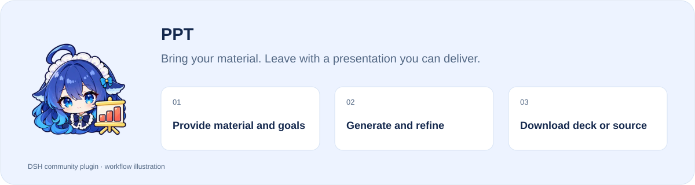
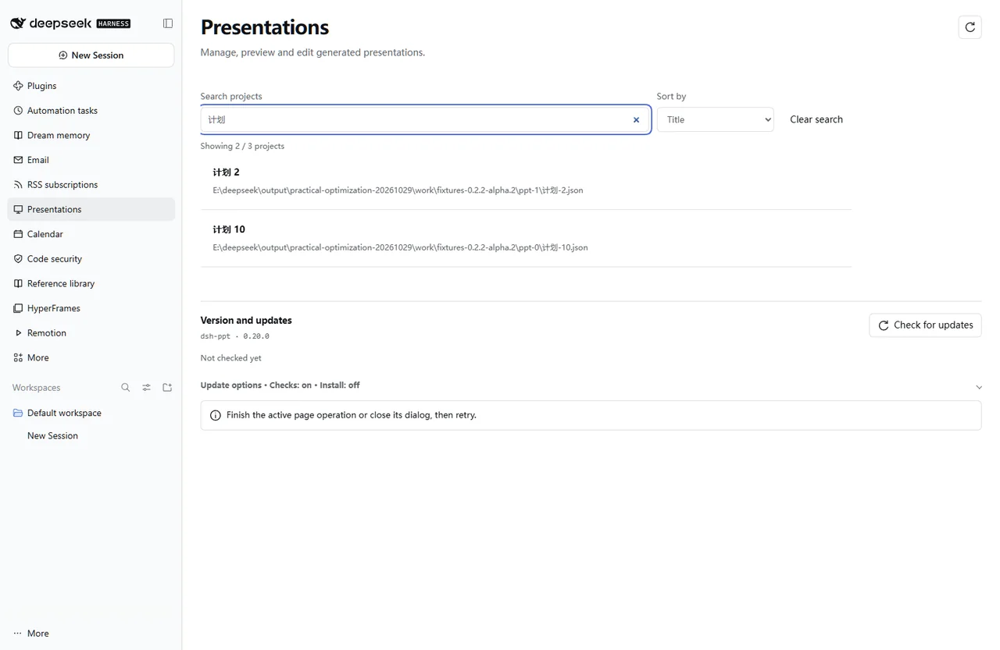

[简体中文](README.md) · **English**

# PPT

**Bring your material. Leave with a presentation you can deliver.**

[](https://www.npmjs.com/package/dsh-ppt) [](https://www.npmjs.com/package/dsh-ppt) [](https://www.npmjs.com/package/dsh-ppt)

**[Install](#install) · [Workflow](#start-using-it) · [Full guide](https://github.com/STARDUSTLC666/dsh-ppt/blob/master/docs/REFERENCE.en.md)**

<picture>
  <source media="(prefers-color-scheme: dark) and (max-width: 640px)" srcset="https://raw.githubusercontent.com/STARDUSTLC666/dsh-ppt/master/docs/assets/intro/workflow-en-mobile-dark.svg">
  <source media="(max-width: 640px)" srcset="https://raw.githubusercontent.com/STARDUSTLC666/dsh-ppt/master/docs/assets/intro/workflow-en-mobile-light.svg">
  <source media="(prefers-color-scheme: dark)" srcset="https://raw.githubusercontent.com/STARDUSTLC666/dsh-ppt/master/docs/assets/intro/workflow-en-dark.svg">
  
</picture>

## Features

- Generate HTML slides, editable PPTX and a project bundle.
- From a single topic, one-click lesson generation (HTML + PPTX + lesson-plan Markdown).
- Optionally edit text, images and slide order with undo.
- Choose traceable data, live scenarios, AI review or rehearsal when needed.

## One-click lessons

Give it a single topic and `ppt_lesson_create` writes the HTML slideshow + editable PPTX + project JSON + a lesson-plan Markdown in one call. For example:

> Make a lesson on “how to run an effective user interview” — workshop format, 45 minutes, for beginners.

It auto-builds the teaching design (7 modes × 4 audience levels, Bloom's taxonomy objectives, interactions and formative assessment, a timed agenda). The result is an editable teaching-structure skeleton — fill the `[To fill: …]` placeholders with real content before delivery. To inspect or edit the plan first, use `ppt_lesson_generate` for structured slides and pass them to `ppt_create`. See the [usage guide](docs/USAGE.md).

<details>
<summary>See a workbench example</summary>



Actual interface with controlled validation data; the PPTX image is a rendered sample when shown.

</details>

## Install

Open **Plugins** in the DSH desktop app and install `dsh-ppt`. If the CLI is available:

```bash
dsh plugin --profile desktop add dsh-ppt
```

For the web profile, replace `desktop` with `web`. Restart that DSH profile after installation. The package’s DSH requirement is `>=0.2.1-rc.3`.

## Start using it

1. Provide material, purpose, audience and slide count in the target workspace; request HTML, PPTX and project files.
2. Open Presentations in the sidebar and search for or select the generated project.
3. Edit slide text, images or order, save and inspect the preview; render the current PPTX when you need to inspect its actual output.
4. Explicitly start optional AI review, rehearsal or visual repair when needed; direct download does not require them.
5. Deliver the share bundle or retain editability with the project bundle; check the result in the target browser or Office application.

Example request：

> Create a deck from this material with HTML, editable PPTX and a project bundle. Confirm the audience and slide count first.

## Before you start

Download the finished deck directly; AI review and rehearsal are optional. Office edits do not sync back into the project.

Configuration, detailed tools and troubleshooting: [full reference](https://github.com/STARDUSTLC666/dsh-ppt/blob/master/docs/REFERENCE.en.md).

## Plugin updates

Check updates at the bottom of the workbench or native plugin details. Automatic checks are on by default; **automatic installation is off**. You choose whether to install and when to restart. Suite-managed components update with their bundle. [Update behavior](https://github.com/STARDUSTLC666/dsh-ppt/blob/master/docs/REFERENCE.en.md).

## Documentation

- [Full usage, configuration and limits](https://github.com/STARDUSTLC666/dsh-ppt/blob/master/docs/REFERENCE.en.md)
- [Release notes](https://github.com/STARDUSTLC666/dsh-ppt/blob/master/CHANGELOG.md)
- [Validation scope and history](https://github.com/STARDUSTLC666/dsh-ppt/blob/master/docs/VALIDATION.md)

## Feedback and contributions

If the plugin helps, a Star makes it easier for others to discover. Report problems or suggest improvements in [Issues](https://github.com/STARDUSTLC666/dsh-ppt/issues); code and documentation [PRs](https://github.com/STARDUSTLC666/dsh-ppt/pulls) are welcome. Include versions and reproduction steps, and remove credentials from reports.

## License

[MIT](https://github.com/STARDUSTLC666/dsh-ppt/blob/master/LICENSE)

<a id="what-it-does"></a>
<a id="requirements-and-configuration"></a>
