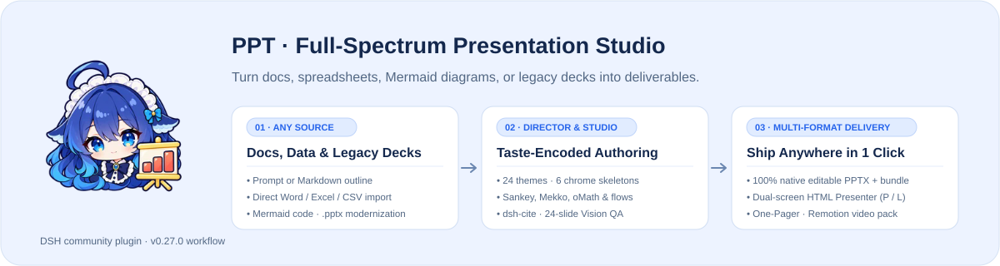
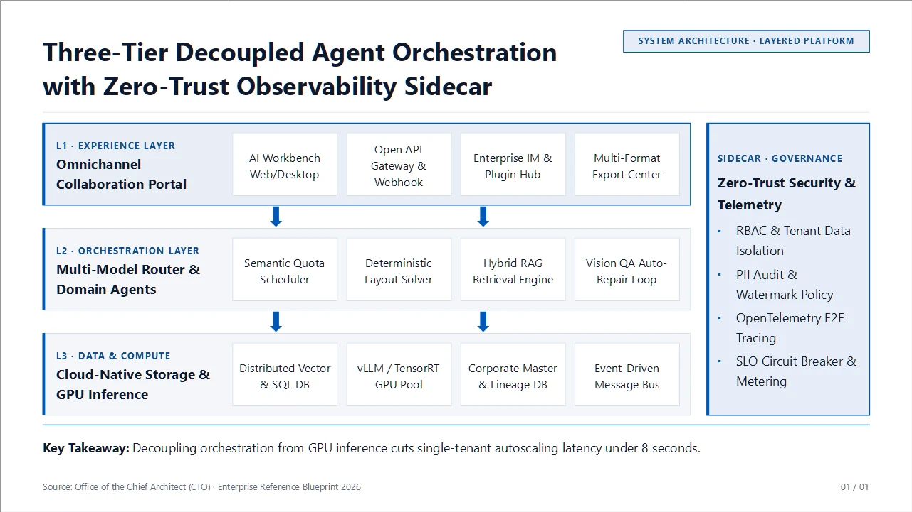
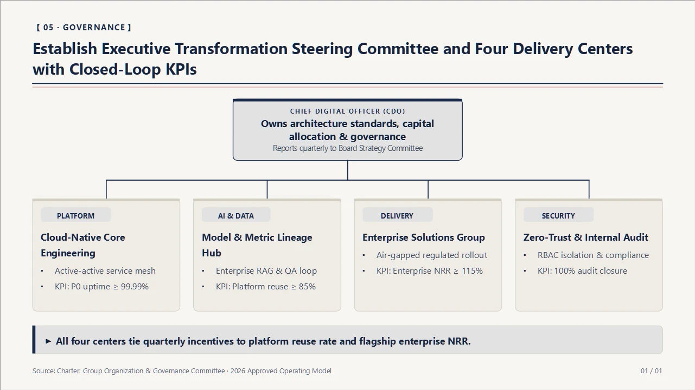

[简体中文](README.md) · **English**

# PPT

**Turn source material into publication-grade, deliverable presentations in DeepSeek Harness—HTML playback, editable PPTX, and project bundles—in a 5-theme light workbench.**

[](https://www.npmjs.com/package/dsh-ppt) [](https://www.npmjs.com/package/dsh-ppt) [](https://www.npmjs.com/package/dsh-ppt)

**[Install](#install) · [Workflow](#start-using-it) · [Full guide](https://github.com/STARDUSTLC666/dsh-ppt/blob/master/docs/REFERENCE.en.md)**

<picture>
  <source media="(prefers-color-scheme: dark) and (max-width: 640px)" srcset="https://raw.githubusercontent.com/STARDUSTLC666/dsh-ppt/master/docs/assets/intro/workflow-en-mobile-dark.svg?v=0.26.0">
  <source media="(max-width: 640px)" srcset="https://raw.githubusercontent.com/STARDUSTLC666/dsh-ppt/master/docs/assets/intro/workflow-en-mobile-light.svg?v=0.26.0">
  <source media="(prefers-color-scheme: dark)" srcset="https://raw.githubusercontent.com/STARDUSTLC666/dsh-ppt/master/docs/assets/intro/workflow-en-dark.svg?v=0.26.0">
  
</picture>

## Features

- **Zero-taste-burden Auto-Director & Native Editable Mermaid Diagrams**: Automatically selects from **24 curated themes** (16 projector-safe daylight + 8 stage dark — spanning McKinsey, BCG Emerald, Economist Brief, FT Salmon, Sequoia Daylight Memo, Stripe Craft, Apple Spatial Light, and Gov Ceremonial), **6 distinct Master Chrome Skeletons**, **20 industry blueprints**, **native `<m:oMath>` + MathML equations**, **zero-dependency Mermaid (`flowchart` & `sequenceDiagram`) → 100% native editable PPTX `<p:sp>` shapes and attached `<p:cxnSp>` connectors**, and **29+ native editable layouts & pro diagrams** (Marimekko market maps, multi-layer Sankey flow diagrams, Porter Value Chain, SWOT cross matrix, interlocking Chevrons, Bento cards, KPI metrics, 2×2 matrices, comparisons, flywheel/funnel flows, Gantt roadmaps, layered architecture diagrams, Harvey-ball matrices, concentric TAM/SAM/SOM, org/team charts, academic 3-line tables, and 13 publication-grade chart types including vector waterfall bridges).
- **Direct Word/Excel/CSV Ingestion, `.pptx` Modernization & `dsh-cite` / `dsh-remotion` Bridges**: Ships **`ppt_from_office`** (zero new dependencies) to ingest `.xlsx` multi-sheet workbooks, `.csv`/`.tsv`, and `.docx` Word reports directly into multi-slide decks (auto-profiling flow sheets to Sankey, schedules to Gantt, share tables to Marimekko, bridges to Waterfall, and mixed-scale metrics to Combo charts); retains **`ppt_import`** for legacy `.pptx` refurbishment and Office round-trip sync (`≤24 MiB`, undoable); adds **`ppt_cite`** to attach verified **`dsh-cite`** references & generate a `References` slide, plus **`ppt_remotion`** to export animated **`dsh-remotion`** video storyboard packs.
- **Human-first Workbench, `? Guide` Spotlight Tour, Pace Budgeter & Multi-Format Delivery**: Adapted for DeepSeek Harness `>=0.2.2-rc.3` with 5 light UI themes; includes a **`? Guide`** 4-step interactive spotlight tour, 1-click **Load Flagship Demo** (`create-demo`), drag-and-drop **`.xlsx`/`.csv`/`.docx`/`.pptx`** import, click-to-edit preview targets (including Mermaid code & LaTeX `formula`s), **Speaking-Pace Budgeter (`targetMinutes` & live overrun badges)**, **Dual-Screen Presenter View** (`P` key + `L` laser), **Executive One-Pager (`.onepager.html` print A4 + mobile long-card toggle)**, **Speaker Handout (`.handout.md`)**, and **Remotion Storyboard `.zip`**.
- **Optional verification & coaching**: Traceable numbers with live what-if sliders across diagrams and tables, 24-slide two-tier Vision QA (12 lossless formatting actions + full-width before/after canvas diff), and executive storyline coaching / defense rehearsal.

## Style previews

Rendered from native editable PPTX files made with dsh-ppt across distinct master chrome skeletons and domain diagrams. Select an image to enlarge it.

<table>
<tr>
  <th>Layered Architecture + Sidecar</th>
  <th>Multi-Quarter PMO Gantt</th>
  <th>Phase-III Clinical Booktabs</th>
</tr>
<tr>
  <td width="33%"><a href="https://raw.githubusercontent.com/STARDUSTLC666/dsh-ppt/master/assets/gallery/v22-arch-en.webp"></a></td>
  <td width="33%"><a href="https://raw.githubusercontent.com/STARDUSTLC666/dsh-ppt/master/assets/gallery/v22-gantt-en.webp"></a></td>
  <td width="33%"><a href="https://raw.githubusercontent.com/STARDUSTLC666/dsh-ppt/master/assets/gallery/v22-clinical-en.webp"></a></td>
</tr>
<tr>
  <th>CFO EBIT Waterfall (FT Salmon)</th>
  <th>Enterprise Harvey Matrix</th>
  <th>Governance &amp; Org Tree (Gov Chrome)</th>
</tr>
<tr>
  <td width="33%"><a href="https://raw.githubusercontent.com/STARDUSTLC666/dsh-ppt/master/assets/gallery/v22-finance-en.webp"></a></td>
  <td width="33%"><a href="https://raw.githubusercontent.com/STARDUSTLC666/dsh-ppt/master/assets/gallery/v22-harvey-en.webp"></a></td>
  <td width="33%"><a href="https://raw.githubusercontent.com/STARDUSTLC666/dsh-ppt/master/assets/gallery/v22-gov-org-en.webp"></a></td>
</tr>
</table>

All previews are LibreOffice-rendered from native OOXML `.pptx` outputs using sample metrics.

<details>
<summary>View the workbench</summary>


Actual interface with controlled validation data; the PPTX image is a rendered sample when shown.

</details>

## Install

Open **Plugins** in the DSH desktop app and install `dsh-ppt`. If the CLI is available:

```bash
dsh plugin --profile desktop add dsh-ppt
```

For the web profile, replace `desktop` with `web`. Restart that DSH profile after installation. The package’s DSH requirement is `>=0.2.2-rc.3`.

## Start using it

Four intuitive steps — start either in chat or directly inside the workbench:

1. **Draft in seconds (three ways)**:
   - **Self-serve in the Workbench**: Open **Presentations** in the sidebar (click **`? Guide`** anytime for the 4-step spotlight tour), click **Load Flagship Demo** for an instant showcase, click **New presentation** to pick from 20 scenario blueprints, or drag-and-drop **`.xlsx` / `.csv` / `.docx` / `.pptx`** directly.
   - **Ask in Chat**: Share Word/Excel/CSV files, Markdown (including ```` ```mermaid ```` flowcharts or sequence diagrams), or a reference `.pptx` path — Auto-Director picks a projector-safe theme and varied layouts automatically, and `ppt_cite` links verified `dsh-cite` references.
2. **Click-to-edit, layouts & speaking-pace budget**: Click any title, card, or table in the live preview to focus its editor field; switch bullets into **Mermaid flowcharts/sequence diagrams, KPI metrics, Marimekko market maps, Sankey flows, Porter Value Chains, SWOT matrices, Gantt timelines, Architecture diagrams, Harvey-ball matrices, or academic 3-line tables** (plus native LaTeX `formula`s), set **Target Duration (min)** to spot over-budget slides live, then press `Ctrl/⌘+S` or **Save slide**.
3. **Import Office/.pptx, round-trip edits & save your brand**: Import `.xlsx`/`.csv`/`.docx` or refurbish legacy `.pptx` files in one click, or sync PowerPoint/WPS edits back via **Sync Edited .pptx** as an undoable revision; in **Style Studio**, apply 8 Master Presets or save a corporate `.pptx` style into **My Brand Library**.
4. **Present, verify & deliver everywhere**: Render the current PPTX for **side-by-side HTML & PPTX inspection** (or run optional AI storyline coaching, rehearsal, or 24-slide visual repair); press `P` during standalone HTML playback for **Dual-Screen Presenter View** (`L` for laser pointer), and download PPTX, **Executive One-Pager (`.onepager.html`)**, **Remotion Storyboard (`.zip`)**, **Handout (`.md`)**, or Share ZIP.

Ready-to-copy chat prompts:

- **Quarterly / OKR review**: `Turn these notes into a Quarterly OKR review deck with action titles, KPI cards, value-chain chevrons, and issue-action comparisons (HTML + editable PPTX).`
- **Clone a corporate `.pptx`**: `Absorb the palette, logo, chrome skeleton, and slide cadence of company-template.pptx, and turn this document into an executive presentation.`

## Before you start

Download the finished deck directly; AI review, rehearsal and visual repair are optional. Import external `.pptx` decks for one-click modernization or sync Office-edited `.pptx` changes back into your workbench project with undo history; press `P` during HTML playback for Dual-Screen Presenter View and export structured `.handout.md` speaker handouts.

Configuration, detailed tools and troubleshooting: [full reference](https://github.com/STARDUSTLC666/dsh-ppt/blob/master/docs/REFERENCE.en.md).

## Plugin updates

Check updates at the bottom of the workbench or native plugin details. Automatic checks are on by default; **automatic installation is off**. You choose whether to install and when to restart. Suite-managed components update with their bundle. [Update behavior](https://github.com/STARDUSTLC666/dsh-ppt/blob/master/docs/REFERENCE.en.md).

## Documentation

- [Full usage, configuration and limits](https://github.com/STARDUSTLC666/dsh-ppt/blob/master/docs/REFERENCE.en.md)
- [Release notes](https://github.com/STARDUSTLC666/dsh-ppt/blob/master/CHANGELOG.md)
- [Validation scope and history](https://github.com/STARDUSTLC666/dsh-ppt/blob/master/docs/VALIDATION.md)

## Feedback and contributions

If the plugin helps, a Star makes it easier for others to discover. Report problems or suggest improvements in [Issues](https://github.com/STARDUSTLC666/dsh-ppt/issues); code and documentation [PRs](https://github.com/STARDUSTLC666/dsh-ppt/pulls) are welcome. Include versions and reproduction steps, and remove credentials from reports.

## License

[MIT](https://github.com/STARDUSTLC666/dsh-ppt/blob/master/LICENSE)

<a id="what-it-does"></a>
<a id="requirements-and-configuration"></a>
