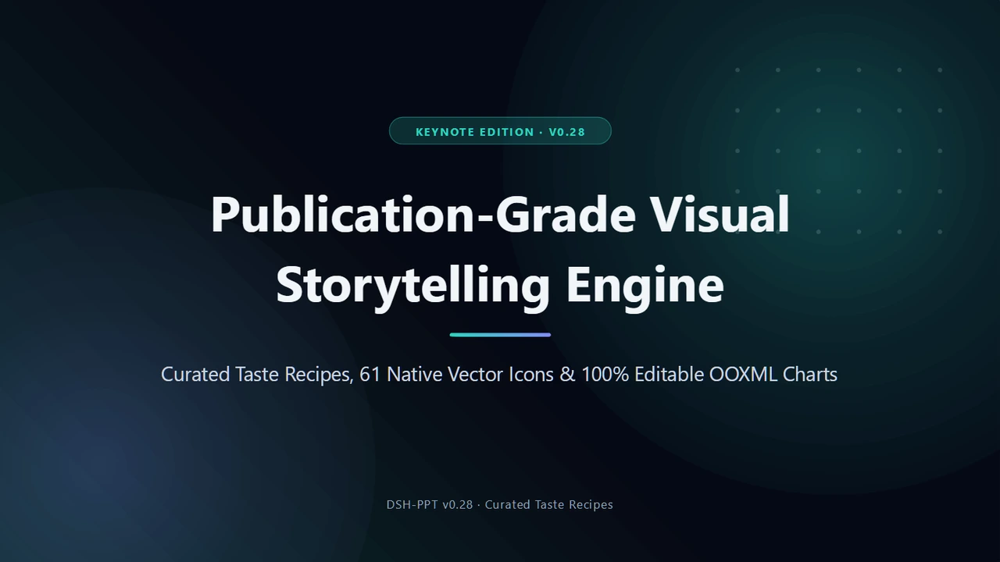
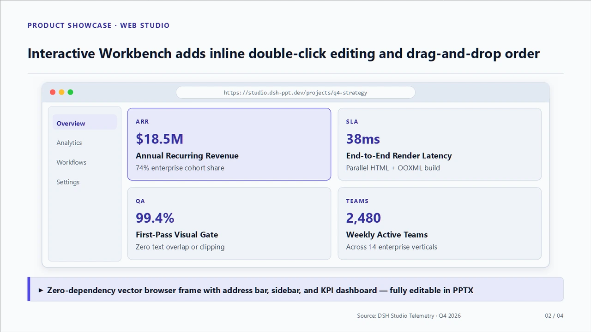

[简体中文](README.md) · **English**

# PPT

**Publication-grade presentation engine & workbench for DeepSeek Harness: Tri-Mode Routing (Direct / 8-Domain Authoritative Research / Mode C Hybrid Local + External Enrichment), SLOP-13/14 governance gates, 41 canonical native-editable layouts + 53 aliases (MECE Issue Tree, Squarified Treemap, OKR Gauge, Pricing Matrix, World/China Maps, 2.5D Isometric, Mermaid, Formulas, Code), 20 Gold Exemplars, 24 themes, reverse Office exports (.xlsx/.docx/.qa-prep/.memo/.i18n), Slide Bank Composer, lossless i18n & offline R-key review feedback loop.**

[](https://www.npmjs.com/package/dsh-ppt) [](https://www.npmjs.com/package/dsh-ppt) [](https://www.npmjs.com/package/dsh-ppt)

**[Install](#install) · [Workflow](#start-using-it) · [Full guide](https://github.com/STARDUSTLC666/dsh-ppt/blob/master/docs/REFERENCE.en.md)**

<picture>
  <source media="(prefers-color-scheme: dark) and (max-width: 640px)" srcset="https://raw.githubusercontent.com/STARDUSTLC666/dsh-ppt/master/docs/assets/intro/workflow-en-mobile-dark.svg?v=0.36.0">
  <source media="(max-width: 640px)" srcset="https://raw.githubusercontent.com/STARDUSTLC666/dsh-ppt/master/docs/assets/intro/workflow-en-mobile-light.svg?v=0.36.0">
  <source media="(prefers-color-scheme: dark)" srcset="https://raw.githubusercontent.com/STARDUSTLC666/dsh-ppt/master/docs/assets/intro/workflow-en-dark.svg?v=0.36.0">
  
</picture>

## Features

- **Tri-Mode Routing, 8-Domain Authoritative Research Engine & Mode C Hybrid Packs (`SLOP-13` 9-Check Gate)**: Supports **Mode A (Direct Build)**, **Mode B (Zero-Material 8-Domain Research with `site:` + `filetype:pdf` + `-site:` 25-domain noise exclusion)**, and **Mode C (Hybrid Local Materials + External Authority)**; `ppt_from_office({ inspectOnly: true })` emits a token-efficient **Material Dossier** & **`enrichmentPlan`** (indexing local `E1..Ek` and returning collision-free `nextEvidenceId`), with `instructions`, `maxSlides`, `includeSheets`, `photoRoles`, `bindDataModel: true` (live Excel → `dataModel`), and automatic `focalPoint: 'top'` for portrait/team photos; code-level `classifySourceAuthority` (T1/T2/T3) + upgraded **`SLOP-13`** intercepts secondary relays, low-authority T3/blocked domains, unmarked forecasts, missing external dates, and stale benchmarks, honoring workspace `brand-kit.json` `preferredSources` & `blockedDomains`.
- **41 Canonical Native-Editable Layouts (36 Core + 5 Media, + 53 Aliases) & 4 Executive Diagrams**: Zero new runtime dependencies, 100% HTML/SVG + editable OOXML parity — adds **McKinsey MECE `issue-tree`**, **Squarified `treemap`**, **Stephen Few OKR `gauge`**, and **Good/Better/Best `pricing`** (plus on-demand `buildLayoutCss` HTML CSS tree-shaking), alongside **World/China Dotted Maps (`map`)**, **2.5D Isometric Stack & Pillars (`isometric`)**, **Magic Quadrant (`quadrant`)**, **Radar (`radar`)**, **Dumbbell (`dumbbell`)**, **Heatmap (`heatmap`)**, **Device Mockups (`mockup`)**, **9-Language Code Terminals (`code`)**, native `<m:oMath>` equations, Mermaid connectors, Marimekko, Sankey, Porter Value Chain, SWOT, Gantt, Architecture, Harvey balls, TAM, Org charts, booktabs tables, and **13 publication-grade chart kinds**.
- **Reverse Office Exports, Slide Bank Composer, Lossless i18n, Step Reveal & Offline `R`-Key Review Loop**: Export optional zero-dep companions via `exports[]` / `--export` — **`.xlsx` Excel data workbook**, **`.docx` Word formal report**, **`.qa-prep.md` executive Q&A defense guide**, **`.memo.md` prose memo**, and **`.i18n.json` translation bundle** (Workbench also downloads `.xlsx`/`.docx`/`.qa-prep.md`); save reusable slides into **`.dsh-ppt/slide-bank.json` (`saveToBank`)** and compose cross-deck builds via **`mergeSources`** (SHA-256 asset dedup + collision-free `[E#]` remapping); apply 100% layout-lossless **`translations` / `bilingualMode`**; control click-by-click **`reveal: 'step'`** (HTML + PPTX `<p:timing>`) & **`motionProfile`**; let stakeholders press **`R`** in offline HTML to pin slide comments & export `review-feedback.json` → `ppt_check({ feedbackPath })` for precision AI revisions.
- **Enterprise Brand Kit Lock (`SLOP-14`), Multi-Audience Remix, Social Carousel & Live Presenter Power Pack**: Persist corporate palette, fonts, logo, footer, content-slide confidentiality watermark (`CONFIDENTIAL · 内部资料`), mandatory closing, and trusted/blocked source lists in `.dsh-ppt/brand-kit.json`; compress decks into **`exec-5min` (6p)** / **`board-brief` (8p)** / **`sales-pitch` (7p)** copies with omitted notes archived losslessly plus **`4:5` / `1:1` Social Carousel HTML**; standalone HTML includes **`Ctrl/Cmd+K` jump search (with `[E#]` evidence)**, **`R` review comments**, **`D` whiteboard pen**, **`T` Q&A countdown timer**, **`A` narrated Auto-Tour**, **`P` Dual-Screen Presenter Console**, **`L` laser pointer**, and **`.srt`/`.vtt` subtitles** (also bundled into `dsh-remotion`).
- **20 Curated Gold Exemplars (12 GitHub OSS-Distilled), 8 Taste Recipes & Zero-LLM Self-Repair Loop**: Ships **13 registered tools**, **24 built-in themes (16 daylight + 8 dark)**, **6 Master Chrome Skeletons**, **8 Taste Recipes**, **20 industry blueprints**, **20 Gold Exemplars** (`exemplar: "auto"`, `alignOrder: true`, Few-Shot JSON), and **61 native `<a:custGeom>` vector icons**; batch-ingest local `.pptx` folders via `ppt_absorb` / `--ingest-exemplars` into `.dsh-ppt/exemplars.json` & `.dsh-ppt/taste-recipes.json`; deterministic Weak-LLM Compensator + pre-commit `SLOP-01..14` Zero-LLM Self-Repair Loop produces zero-warning decks with 0 extra LLM calls.
- **Multi-Source Ingestion, Physical Slide Lightbox Workbench & Ecosystem Bridges**: `ppt_from_office` ingests `.pdf`/`.docx`/`.xlsx`/`.csv`/`.tsv`/`.png`/`.jpg`/`.webp` packs with zero new dependencies; `ppt_import` refurbishes legacy `.pptx` files and syncs Office round-trip edits with undo history; `ppt_cite` links `dsh-cite` references and `ppt_remotion` exports `dsh-remotion` packs; Workbench (`DSH >=0.2.2-rc.3`, 13 styles + 8 font pairings) opens decks directly into an illuminated **16:9 Physical Slide Lightbox** (drag or `←/→` reorder, duplicate, insert starter transparencies) with 1-click entry into **Slide Studio** (double-click inline edits, Evidence Ledger & Revision Diff drawers, 1-click exports for PPTX/PDF/PNG-ZIP/XLSX/DOCX/QA-Prep/One-Pager/Carousel/Subtitles, plus optional **live what-if data lineage, 24-slide Vision QA, and rehearsal coaching**).

## Style previews

Every preview below is LibreOffice-rendered directly from **100% native editable `.pptx`** files built by `dsh-ppt` (`missingFonts: []`). Select any image to enlarge.

<table>
<tr>
  <th>Keynote Glow Poster Cover</th>
  <th>Glass Bento + Native Vector Icons</th>
  <th>Syntax-Highlighted Code Terminal</th>
</tr>
<tr>
  <td width="33%"><a href="https://raw.githubusercontent.com/STARDUSTLC666/dsh-ppt/master/assets/gallery/v28-cover-keynote-en.webp"></a></td>
  <td width="33%"><a href="https://raw.githubusercontent.com/STARDUSTLC666/dsh-ppt/master/assets/gallery/v28-bento-glass-en.webp"></a></td>
  <td width="33%"><a href="https://raw.githubusercontent.com/STARDUSTLC666/dsh-ppt/master/assets/gallery/v28-code-showcase-en.webp"></a></td>
</tr>
<tr>
  <th>SaaS Browser Device Mockup</th>
  <th>Magic Quadrant Matrix</th>
  <th>Six-Dimension Radar Benchmark</th>
</tr>
<tr>
  <td width="33%"><a href="https://raw.githubusercontent.com/STARDUSTLC666/dsh-ppt/master/assets/gallery/v28-mockup-browser-en.webp"></a></td>
  <td width="33%"><a href="https://raw.githubusercontent.com/STARDUSTLC666/dsh-ppt/master/assets/gallery/v28-quadrant-en.webp"></a></td>
  <td width="33%"><a href="https://raw.githubusercontent.com/STARDUSTLC666/dsh-ppt/master/assets/gallery/v28-radar-en.webp"></a></td>
</tr>
</table>

All previews are LibreOffice-rendered from native OOXML `.pptx` outputs using sample metrics.

<details>
<summary>View the workbench</summary>


Actual interface with controlled validation data; the PPTX image is a rendered sample when shown.

</details>

## Install

Open **Plugins** in the DSH desktop app and install `dsh-ppt`. If the CLI is available:

```bash
dsh plugin --profile desktop add dsh-ppt
```

For the web profile, replace `desktop` with `web`. Restart that DSH profile after installation. The package’s DSH requirement is `>=0.2.2-rc.3`.

## Start using it

Four intuitive steps — start either in chat or directly inside the workbench:

1. **Draft in seconds (three ways)**:
   - **Self-serve in the Workbench**: Open **Presentations** in the sidebar (click **`? Guide`** anytime for the 4-step spotlight tour), click **Load Flagship Demo** for an instant showcase, click **New presentation** to pick from 20 scenario blueprints, or drag-and-drop **`.xlsx` / `.csv` / `.docx` / `.pptx`** directly.
   - **Ask in Chat**: Share Word/Excel/CSV files, Markdown (including ```` ```mermaid ```` flowcharts or sequence diagrams), or a reference `.pptx` path — Auto-Director picks a projector-safe theme and varied layouts automatically, and `ppt_cite` links verified `dsh-cite` references.
2. **Physical Slide Lightbox → Slide Studio**: Opening any deck launches the illuminated 16:9 **Lightbox** overview with slide stamps, layout badges, and quality dots — drag or click `←/→` to reorder, duplicate inline, or insert 31+ starter archetypes from the trailing card; click any transparency (or toggle **Slide Studio**) to edit inline by double-clicking text, switch across **41 layouts (MECE Issue Tree, Treemap, OKR Gauge, Pricing, Mermaid, World/China Maps, 2.5D Isometric & LaTeX formulas)**, monitor **Target Duration (min)**, and press `Ctrl/⌘+S` to sync HTML & PPTX.
3. **Import Office/.pptx, round-trip edits & save your brand**: Import `.xlsx`/`.csv`/`.docx` or refurbish legacy `.pptx` files in one click, or sync PowerPoint/WPS edits back via **Sync Edited .pptx** as an undoable revision; in **Style Studio**, apply 8 Master Presets or save a corporate `.pptx` style into **My Brand Library**.
4. **Present, verify & deliver everywhere**: Render the current PPTX for **side-by-side HTML & PPTX inspection** (or run optional AI storyline coaching, rehearsal, or 24-slide visual repair); press `P` during standalone HTML playback for **Dual-Screen Presenter View** (`L` for laser pointer), and download PPTX, **Executive One-Pager (`.onepager.html`)**, **Remotion Storyboard (`.zip`)**, **Handout (`.md`)**, or Share ZIP.

Ready-to-copy chat prompts:

- **Quarterly / OKR review**: `Turn these notes into a Quarterly OKR review deck with action titles, KPI cards, value-chain chevrons, and issue-action comparisons (HTML + editable PPTX).`
- **Clone a corporate `.pptx`**: `Absorb the palette, logo, chrome skeleton, and slide cadence of company-template.pptx, and turn this document into an executive presentation.`

## Before you start

Download the finished deck directly; AI review, rehearsal and visual repair are optional. CLI and skill error messages are in Chinese. Import external `.pptx` decks for one-click modernization or sync Office-edited `.pptx` changes back into your workbench project with undo history; standalone HTML includes Dual-Screen Presenter View (`P`), offline review comment export (`R` → `review-feedback.json` for AI revision), and companion `.xlsx` / `.docx` / `.qa-prep.md` / `.handout.md` exports.

Configuration, detailed tools and troubleshooting: [full reference](https://github.com/STARDUSTLC666/dsh-ppt/blob/master/docs/REFERENCE.en.md).

## Plugin updates

Check updates at the bottom of the workbench or native plugin details. Automatic checks are on by default; **automatic installation is off**. You choose whether to install and when to restart. Suite-managed components update with their bundle. [Update behavior](https://github.com/STARDUSTLC666/dsh-ppt/blob/master/docs/REFERENCE.en.md).

## Documentation

- [Full usage, configuration and limits](https://github.com/STARDUSTLC666/dsh-ppt/blob/master/docs/REFERENCE.en.md)
- [Release notes](https://github.com/STARDUSTLC666/dsh-ppt/blob/master/CHANGELOG.md)
- [Validation scope and history](https://github.com/STARDUSTLC666/dsh-ppt/blob/master/docs/VALIDATION.md)

## Feedback and contributions

If the plugin helps, a Star makes it easier for others to discover. Report problems or suggest improvements in [Issues](https://github.com/STARDUSTLC666/dsh-ppt/issues); code and documentation [PRs](https://github.com/STARDUSTLC666/dsh-ppt/pulls) are welcome. Include versions and reproduction steps, and remove credentials from reports.

## License

[MIT](https://github.com/STARDUSTLC666/dsh-ppt/blob/master/LICENSE)

<a id="what-it-does"></a>
<a id="requirements-and-configuration"></a>
