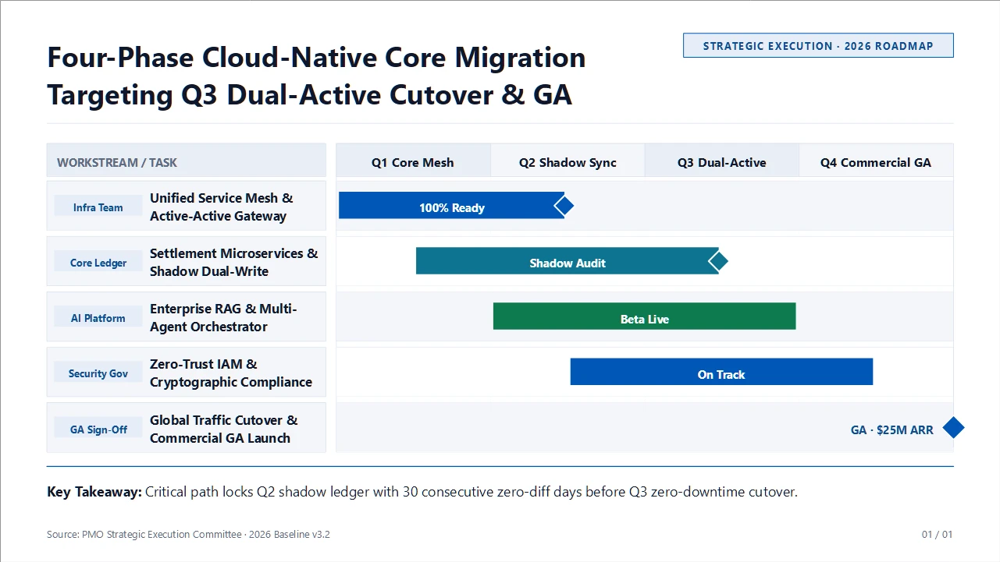
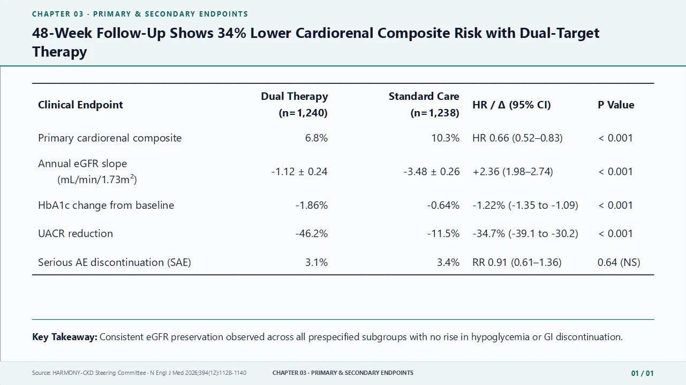
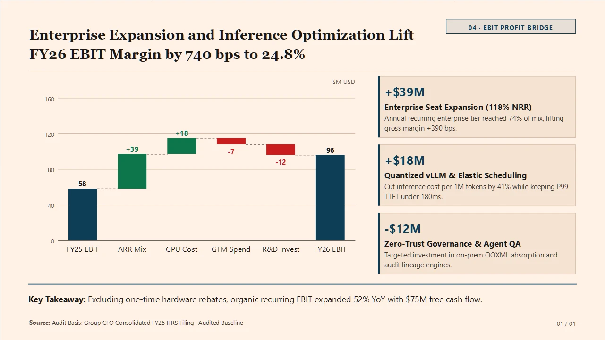
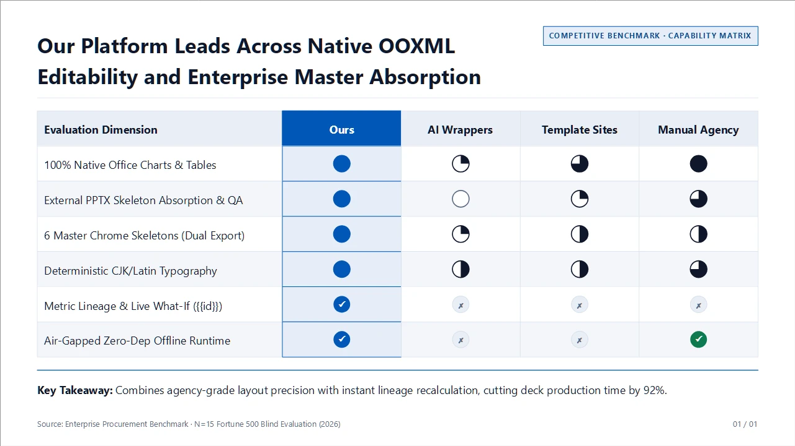
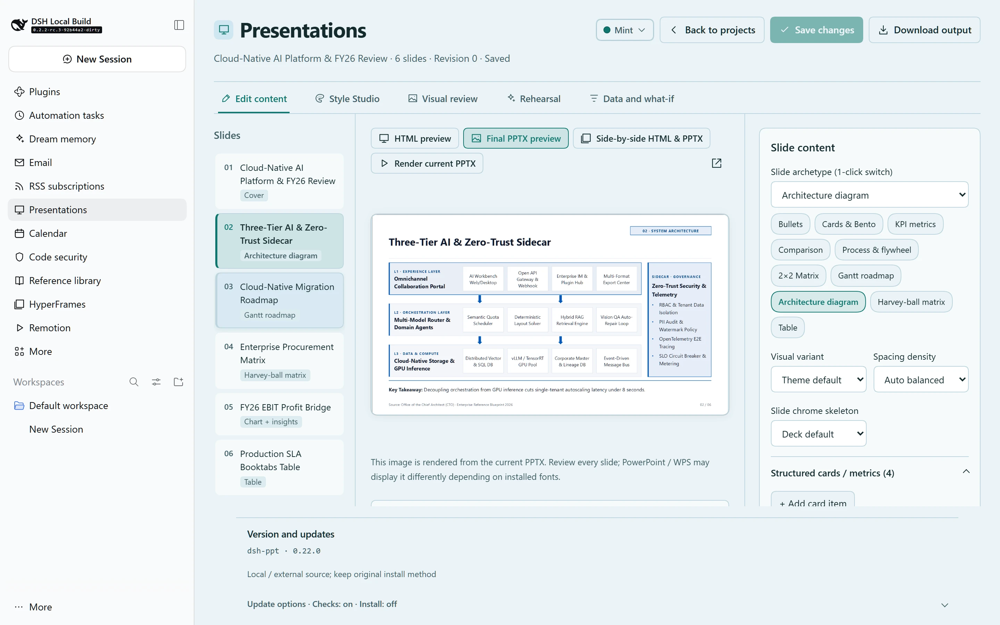

[简体中文](README.md) · **English**

# PPT

**Turn source material into publication-grade, deliverable presentations in DeepSeek Harness—HTML playback, editable PPTX, and project bundles—in a 5-theme light workbench.**

[](https://www.npmjs.com/package/dsh-ppt) [](https://www.npmjs.com/package/dsh-ppt) [](https://www.npmjs.com/package/dsh-ppt)

**[Install](#install) · [Workflow](#start-using-it) · [Full guide](https://github.com/STARDUSTLC666/dsh-ppt/blob/master/docs/REFERENCE.en.md)**

<picture>
  <source media="(prefers-color-scheme: dark) and (max-width: 640px)" srcset="https://raw.githubusercontent.com/STARDUSTLC666/dsh-ppt/master/docs/assets/intro/workflow-en-mobile-dark.svg">
  <source media="(max-width: 640px)" srcset="https://raw.githubusercontent.com/STARDUSTLC666/dsh-ppt/master/docs/assets/intro/workflow-en-mobile-light.svg">
  <source media="(prefers-color-scheme: dark)" srcset="https://raw.githubusercontent.com/STARDUSTLC666/dsh-ppt/master/docs/assets/intro/workflow-en-dark.svg">
  
</picture>

## Features

- **Zero-taste-burden Auto-Director**: Automatically selects from **24 curated themes** (16 projector-safe daylight + 8 stage dark — spanning McKinsey, BCG Emerald, Economist Brief, FT Salmon, Sequoia Daylight Memo, Stripe Craft, Apple Spatial Light, and Gov Ceremonial), **6 distinct Master Chrome Skeletons**, **20 industry blueprints**, and **24+ native editable layouts & pro diagrams** (including interlocking **Value-Chain Chevrons**, Bento cards, KPI hero metrics, 2×2 matrices, comparisons, process/flywheel/funnel flows, Gantt roadmaps, layered architecture diagrams, Harvey-ball competitor matrices, concentric TAM/SAM/SOM, org/team charts, academic 3-line tables, and 13 publication-grade chart types including vector waterfall bridges).
- **Deep Reference `.pptx` Absorption & Master Presets**: Ships **8 1-click World-Class Reference Presets** plus **Deep `.pptx` Absorption** (`ppt_absorb`, `referencePptx` with `cloneStructure: true`, or drag-and-drop up to `24 MiB` in Style Studio) — recursively unwrapping nested `<p:grpSp>` group shapes, resolving OOXML `sysClr`/`prstClr`/`hueMod` color transforms, dual brand accents, heading/body font pairings, dark-cover + daylight-body polarity, master logos, `recommendedChrome`, and 24-layout `slideSkeleton` sequences with WCAG ≥4.5:1 sanitization and reusable **My Brand Library** presets.
- **Human-first Workbench & Self-Serve Creation**: Adapted for DeepSeek Harness `>=0.2.2-rc.3` with 5 switchable light UI themes; launch **New presentation** directly inside the workbench from a blueprint, rough notes, or uploaded `.pptx`; click text/cards/tables in the live preview to jump straight to their editor inputs, insert Harvey balls (`● ◕ ◑ ◔ ○`) in 1 click, compare HTML ↔ rendered PPTX side-by-side, and undo up to 20 revisions.
- **Optional verification & coaching**: Traceable numbers with live what-if sliders across diagrams and tables, 24-slide two-tier Vision QA (12 lossless formatting actions + full-width before/after canvas diff), and executive storyline coaching / defense rehearsal.

## Style previews

Rendered from native editable PPTX files made with dsh-ppt across distinct master chrome skeletons and domain diagrams. Select an image to enlarge it.

<table>
<tr>
  <th>Layered Architecture + Sidecar</th>
  <th>Multi-Quarter PMO Gantt</th>
  <th>Phase-III Clinical Booktabs</th>
</tr>
<tr>
  <td width="33%"><a href="https://raw.githubusercontent.com/STARDUSTLC666/dsh-ppt/master/assets/gallery/v22-arch-en.webp"></a></td>
  <td width="33%"><a href="https://raw.githubusercontent.com/STARDUSTLC666/dsh-ppt/master/assets/gallery/v22-gantt-en.webp"></a></td>
  <td width="33%"><a href="https://raw.githubusercontent.com/STARDUSTLC666/dsh-ppt/master/assets/gallery/v22-clinical-en.webp"></a></td>
</tr>
<tr>
  <th>CFO EBIT Waterfall (FT Salmon)</th>
  <th>Enterprise Harvey Matrix</th>
  <th>Governance &amp; Org Tree (Gov Chrome)</th>
</tr>
<tr>
  <td width="33%"><a href="https://raw.githubusercontent.com/STARDUSTLC666/dsh-ppt/master/assets/gallery/v22-finance-en.webp"></a></td>
  <td width="33%"><a href="https://raw.githubusercontent.com/STARDUSTLC666/dsh-ppt/master/assets/gallery/v22-harvey-en.webp"></a></td>
  <td width="33%"><a href="https://raw.githubusercontent.com/STARDUSTLC666/dsh-ppt/master/assets/gallery/v22-gov-org-en.webp"></a></td>
</tr>
</table>

All previews are LibreOffice-rendered from native OOXML `.pptx` outputs using sample metrics.

<details>
<summary>View the workbench</summary>



Actual interface with controlled validation data; the PPTX image is a rendered sample when shown.

</details>

## Install

Open **Plugins** in the DSH desktop app and install `dsh-ppt`. If the CLI is available:

```bash
dsh plugin --profile desktop add dsh-ppt
```

For the web profile, replace `desktop` with `web`. Restart that DSH profile after installation. The package’s DSH requirement is `>=0.2.2-rc.3`.

## Start using it

Four intuitive steps — start either in chat or directly inside the workbench:

1. **Draft in seconds (two ways)**:
   - **Self-serve in the Workbench**: Open **Presentations** in the sidebar and click **New presentation** to start from any of the 20 scenario blueprints (Quarterly OKR, Product PRD, Investor Memo, Industry Research, Project Update, Defense, etc.), paste rough Markdown notes, or upload a reference `.pptx`.
   - **Ask in Chat**: Share your notes, data, or reference `.pptx` path (or copy a ready-made prompt from the workbench guide) — Auto-Director picks a projector-safe theme and varied layouts automatically.
2. **Click-to-edit & upgrade layouts**: Click any title, card, or table in the live preview to focus its editor field; switch bullets into **KPI hero metrics, Value-Chain Chevrons, Gantt timelines, Architecture diagrams, Harvey-ball matrices, or academic 3-line tables** in one click, then press `Ctrl/⌘+S` or **Save slide**.
3. **Absorb reference `.pptx` & save your brand**: In **Style Studio**, apply **8 built-in Master Reference Presets** in 1 click, or drop a corporate `.pptx` (`≤24 MiB`) to extract dual brand colours, heading/body fonts, cover polarity, logo, and skeleton — then save it to **My Brand Library** for 1-click reuse on future decks.
4. **Verify & deliver**: Render the current PPTX for **side-by-side HTML & PPTX inspection** (or optionally run AI storyline coaching, rehearsal, or 24-slide visual repair), then click **Download PPTX** or export the Share ZIP bundle.

Ready-to-copy chat prompts:

- **Quarterly / OKR review**: `Turn these notes into a Quarterly OKR review deck with action titles, KPI cards, value-chain chevrons, and issue-action comparisons (HTML + editable PPTX).`
- **Clone a corporate `.pptx`**: `Absorb the palette, logo, chrome skeleton, and slide cadence of company-template.pptx, and turn this document into an executive presentation.`

## Before you start

Download the finished deck directly; AI review, rehearsal and visual repair are optional. Office edits do not sync back into the project.

Configuration, detailed tools and troubleshooting: [full reference](https://github.com/STARDUSTLC666/dsh-ppt/blob/master/docs/REFERENCE.en.md).

## Plugin updates

Check updates at the bottom of the workbench or native plugin details. Automatic checks are on by default; **automatic installation is off**. You choose whether to install and when to restart. Suite-managed components update with their bundle. [Update behavior](https://github.com/STARDUSTLC666/dsh-ppt/blob/master/docs/REFERENCE.en.md).

## Documentation

- [Full usage, configuration and limits](https://github.com/STARDUSTLC666/dsh-ppt/blob/master/docs/REFERENCE.en.md)
- [Release notes](https://github.com/STARDUSTLC666/dsh-ppt/blob/master/CHANGELOG.md)
- [Validation scope and history](https://github.com/STARDUSTLC666/dsh-ppt/blob/master/docs/VALIDATION.md)

## Feedback and contributions

If the plugin helps, a Star makes it easier for others to discover. Report problems or suggest improvements in [Issues](https://github.com/STARDUSTLC666/dsh-ppt/issues); code and documentation [PRs](https://github.com/STARDUSTLC666/dsh-ppt/pulls) are welcome. Include versions and reproduction steps, and remove credentials from reports.

## License

[MIT](https://github.com/STARDUSTLC666/dsh-ppt/blob/master/LICENSE)

<a id="what-it-does"></a>
<a id="requirements-and-configuration"></a>
