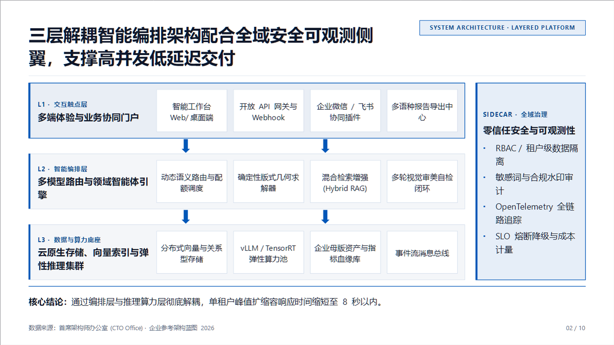
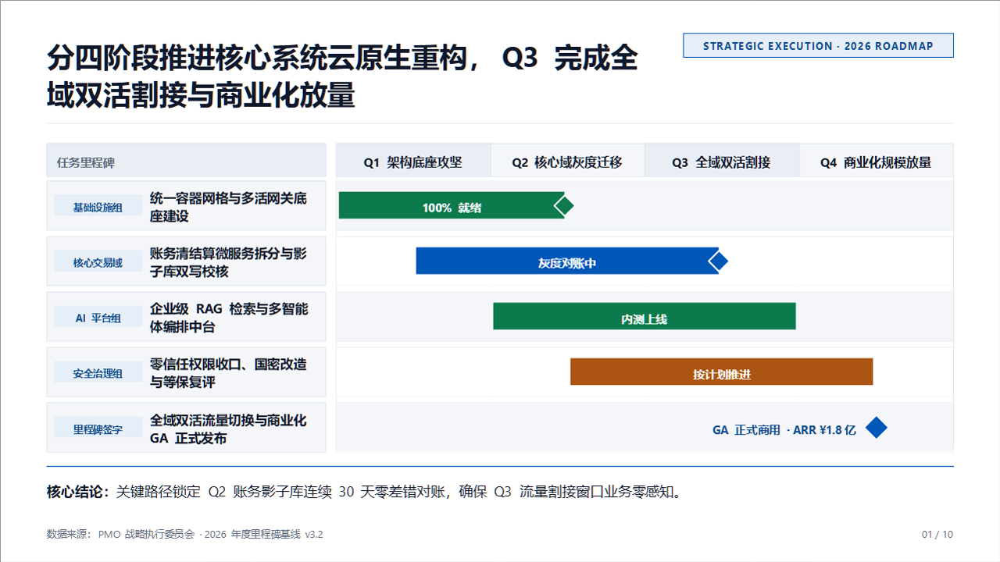
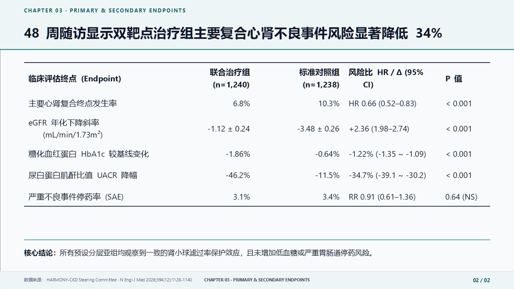
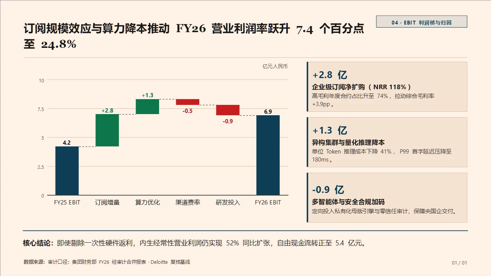
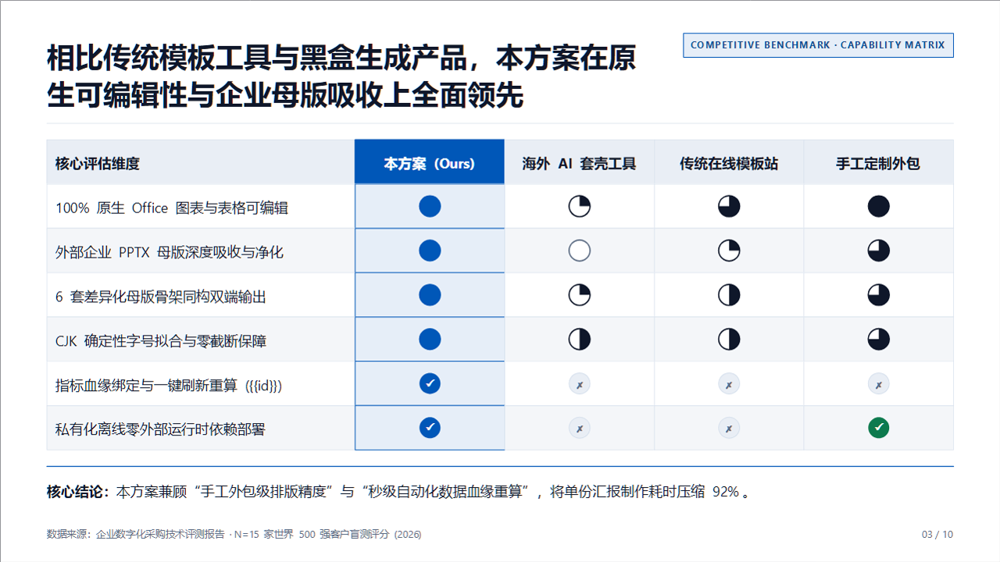
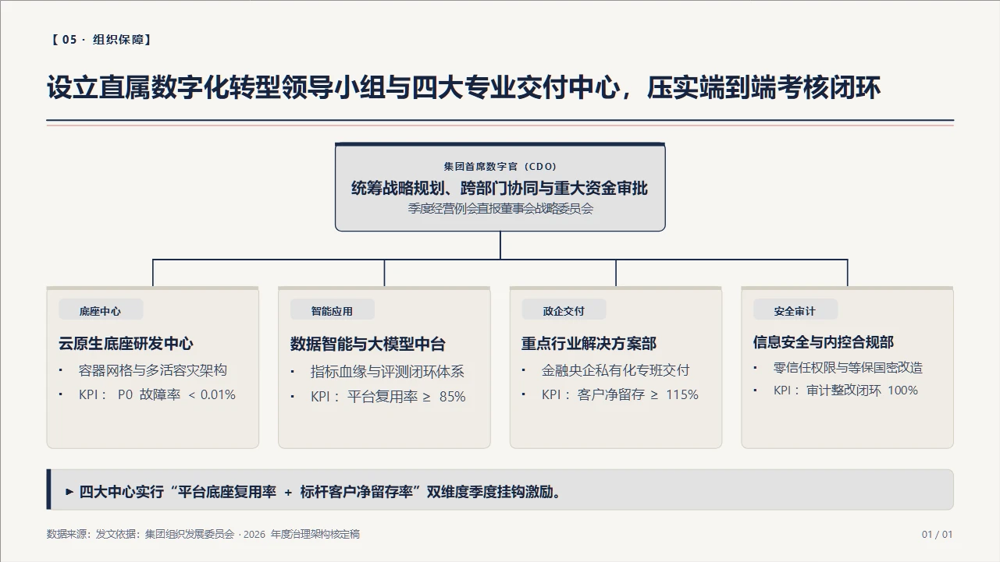

**简体中文** · [English](README.en.md)

# PPT

**在 DeepSeek Harness 中将材料整理为有审美品味、可直接交付的演示文稿，导出离线 HTML、可编辑 PPTX 与工程包，内置可切换五套明亮风格的工作台界面。**

[](https://www.npmjs.com/package/dsh-ppt) [](https://www.npmjs.com/package/dsh-ppt) [](https://www.npmjs.com/package/dsh-ppt)

**[安装使用](#安装) · [使用流程](#开始使用) · [完整说明](https://github.com/STARDUSTLC666/dsh-ppt/blob/master/docs/REFERENCE.zh.md)**

<picture>
  <source media="(prefers-color-scheme: dark) and (max-width: 640px)" srcset="https://raw.githubusercontent.com/STARDUSTLC666/dsh-ppt/master/docs/assets/intro/workflow-zh-mobile-dark.svg?v=0.26.0">
  <source media="(max-width: 640px)" srcset="https://raw.githubusercontent.com/STARDUSTLC666/dsh-ppt/master/docs/assets/intro/workflow-zh-mobile-light.svg?v=0.26.0">
  <source media="(prefers-color-scheme: dark)" srcset="https://raw.githubusercontent.com/STARDUSTLC666/dsh-ppt/master/docs/assets/intro/workflow-zh-dark.svg?v=0.26.0">
  
</picture>

## 功能

- **零品味负担自动导演 & 原生可编辑 Mermaid 流程图**：无需懂排版配色，一句话或文档自动匹配 **24 套大师主题**（16 套明亮投影友好 + 8 套沉浸深色，涵盖麦肯锡、BCG 翡翠战略、经济学人、金融时报、红杉创投、Stripe 工程、Apple 空间白与故宫霁蓝政务）与 **6 套差异化母版骨架**，覆盖 **20 套行业场景蓝图**、**原生 `<m:oMath>` 数学公式**、**Mermaid 流程图/时序图直转原生可编辑 PPTX 形状与吸附连接线（`<p:cxnSp>`）**，以及 **29+ 种原生可编辑版式与专业图示**（麦肯锡不等宽市场图 `marimekko`、财报级多层桑基图 `sankey`、波特价值链 `value-chain`、SWOT 十字矩阵 `swot`、价值链箭头 `chevron`、Bento 网格、KPI 大数字、2×2 矩阵、痛点对比、飞轮/漏斗、甘特图路线图、分层系统架构、哈维球竞品矩阵、TAM/SAM/SOM 同心圆、组织图谱、学术三线表、13 种出版级图表与矢量瀑布桥）。
- **全格式直吞与生态联动（Word / Excel / CSV / PPTX / Cite / Remotion）**：新增 `ppt_from_office` 支持零外部依赖直吞 **`.xlsx` 多工作表 / `.csv` / `.tsv` 与 `.docx` Word 报告**（自动识别流向表→桑基图、排期→甘特图、份额→Mekko、增减桥→瀑布图、指标→组合图与三线表）；保留 `ppt_import` 外部 `.pptx` 一键翻新与 Office 双向导回（≤24 MiB 内存解析，保留撤销历史）；新增 `ppt_cite` 联动 **`dsh-cite`** 核验文献并生成真实参考文献页，以及 `ppt_remotion` 导出 **`dsh-remotion`** 动画视频分镜包。
- **符合直觉的工作台、`? 引导` 交互导览与全场景交付**：适配 DeepSeek Harness `>=0.2.2-rc.3`，内置五套明亮主题切换；支持右上角 **`? 引导`** 四步聚光灯交互导览、空态/新建向导 **「一键体验旗舰示例」** 与 **「导入 Office / PPTX」**、点击预览画面直定位编辑文字 / LaTeX 公式 / Mermaid 代码、**演讲时长预算器（Speaking-Pace Budgeter，设置目标分钟数并实时标记超预算页）**；导出除原生 PPTX / 工程包 / 讲义 `.handout.md` 外，新增 **高管一页纸（Executive One-Pager，支持 A4 打印 PDF 与长图战报切换）**、**Remotion 视频分镜包（`.zip`）** 与独立 HTML 放映 **`P` 键双屏演讲者提词台 + `L` 键虚拟激光笔**。
- **可选高阶能力**：数字溯源与现场推演（支持卡片/甘特图/TAM/哈维球/架构绑定）、24 页双层 AI 视觉审查（含 12 种无损排版修复与全宽前后对比）、高管叙事预审与模拟答辩。

## 风格预览

这些画面来自插件生成的 PPTX（覆盖 6 套母版骨架与高密度专业图示）。点击查看大图。

<table>
<tr>
  <th>系统架构评审（Architecture）</th>
  <th>研发 PMO 跨季排期（Gantt）</th>
  <th>医学临床三期试验（Beamer 三线表）</th>
</tr>
<tr>
  <td width="33%"><a href="https://raw.githubusercontent.com/STARDUSTLC666/dsh-ppt/master/assets/gallery/v22-arch-zh.webp"></a></td>
  <td width="33%"><a href="https://raw.githubusercontent.com/STARDUSTLC666/dsh-ppt/master/assets/gallery/v22-gantt-zh.webp"></a></td>
  <td width="33%"><a href="https://raw.githubusercontent.com/STARDUSTLC666/dsh-ppt/master/assets/gallery/v22-clinical-zh.webp"></a></td>
</tr>
<tr>
  <th>CFO 财务利润桥与归因（FT Waterfall）</th>
  <th>政企选型技术盲测矩阵（Harvey）</th>
  <th>集团治理与双线政务章回（Org Tree）</th>
</tr>
<tr>
  <td width="33%"><a href="https://raw.githubusercontent.com/STARDUSTLC666/dsh-ppt/master/assets/gallery/v22-finance-zh.webp"></a></td>
  <td width="33%"><a href="https://raw.githubusercontent.com/STARDUSTLC666/dsh-ppt/master/assets/gallery/v22-harvey-zh.webp"></a></td>
  <td width="33%"><a href="https://raw.githubusercontent.com/STARDUSTLC666/dsh-ppt/master/assets/gallery/v22-gov-org-zh.webp"></a></td>
</tr>
</table>

以上画面均由原生可编辑 PPTX 经 LibreOffice 渲染生成，使用示例脱敏数据。

<details>
<summary>查看工作台界面</summary>


图片来自验证环境的真实界面或示例 PPTX 渲染，使用示例数据。

</details>

## 安装

在 DSH 桌面版「插件」面板安装 `dsh-ppt`。已配置命令行时也可使用：

```bash
dsh plugin --profile desktop add dsh-ppt
```

网页版把 `desktop` 改为 `web`；安装后重启对应的 DSH。宿主要求以包声明 `>=0.2.2-rc.3` 为准。

## 开始使用

符合直觉的四步工作流（无需记参数，对话或工作台均可直接起步）：

1. **快速起稿（三选一）**：
   - **直接在面板起稿或一键体验**：从左侧栏打开「演示文稿」（可随时点顶部 **`? 引导`** 启动四步导览），点击 **「一键体验旗舰示例」** 零延迟预览旗舰版式，或点击 **「新建演示文稿」** 从 20 套行业蓝图起步，或拖入 **`.xlsx` / `.csv` / `.docx` / `.pptx`** 直接建稿。
   - **在对话中交给助手**：把 Word、Excel/CSV、Markdown（含 ```` ```mermaid ```` 流程图/时序图）或参考 `.pptx` 发给助手，自动导演会按听众匹配明亮投影风与多版式节奏，并可调用 `ppt_cite` 关联 `dsh-cite` 真实文献。
2. **点哪改哪 & 换版式与时长预算**：在「内容编辑」直接点击预览画面里的标题、卡片或表格即可定位到右侧编辑框；顶部可一键切换 **Mermaid 流程图/时序图、KPI 大数字、不等宽市场图（Marimekko）、桑基流向图（Sankey）、波特价值链、SWOT 矩阵、甘特图、系统架构图、哈维球矩阵或学术三线表**（并支持 LaTeX 原生公式），设置 **目标演讲时长（分钟）** 实时检查每页超时风险，改完按 `Ctrl/⌘+S` 或点击「保存此页」同步更新 HTML 与 PPTX。
3. **导入翻新、Office 导回与品牌沉淀**：支持点击「**导入 PPTX 翻新**」或「**导入 Word/Excel**」直接重塑现有文件，或在 PowerPoint / WPS 微调后通过「**导入 Office 修改稿**」同步回工作台（保留撤销历史）；也可在「风格与母版」一键套用 8 套名家范本或收藏公司模板到「我的品牌库」。
4. **双屏演讲、一页纸与视频分镜交付**：需要精检排版时点「渲染当前 PPTX」开启 **HTML + PPTX 并排对比**（或按需开启 AI 叙事预审、模拟答辩与 24 页视觉看图修复）；放映 HTML 时按 `P` 开启双屏提词台、按 `L` 使用虚拟激光笔，并在下载菜单一键导出最新 PPTX、**高管一页纸（`.onepager.html`）**、**Remotion 视频分镜包（`.zip`）**、**演讲讲义（`.md`）** 或分享包 ZIP。

常用对话指令示例（可直接复制告诉助手）：

- **日常汇报 / OKR 复盘**：`请把这份材料整理成季度 OKR 复盘演示文稿，结论先行，用 KPI 卡片、价值链箭头和痛点对比排版，生成 HTML 和可编辑 PPTX。`
- **吸收公司模板做新稿**：`参考工作区里的 company-template.pptx 吸收配色、Logo、母版骨架与版式节奏，把这份纪要做成一套可直接投影的正式汇报 PPT。`
- **产品方案 / 融资路演**：`按明亮易读的投资备忘录风格把这份产品方案做成 10 页路演 PPT，包含 TAM 市场空间、竞品哈维球矩阵和里程碑甘特图。`

## 开始前要知道

可直接下载成品；AI 预审、模拟答辩与看图修复均按需开启。支持导入外部 PPTX 一键翻新，或在 Office 微调后导回工作台更新工程；内置按 P 开启双屏演讲者提词台与讲义导出。

配置、完整工具与排错见[详细使用说明](https://github.com/STARDUSTLC666/dsh-ppt/blob/master/docs/REFERENCE.zh.md)。

## 插件更新

在工作台或原生插件详情页底部检查更新。默认自动检查，**默认不自动安装**；是否安装、何时重启由你决定。Suite 管理的组件随整包更新。[查看更新规则](https://github.com/STARDUSTLC666/dsh-ppt/blob/master/docs/REFERENCE.zh.md)。

## 文档

- [详细使用、配置与边界](https://github.com/STARDUSTLC666/dsh-ppt/blob/master/docs/REFERENCE.zh.md)
- [更新记录](https://github.com/STARDUSTLC666/dsh-ppt/blob/master/CHANGELOG.md)
- [验证范围与历史](https://github.com/STARDUSTLC666/dsh-ppt/blob/master/docs/VALIDATION.md)

## 反馈与贡献

如果插件帮到了你，欢迎 Star，让更多人发现它。问题和建议请提交 [Issues](https://github.com/STARDUSTLC666/dsh-ppt/issues)，也欢迎代码与文档 [PR](https://github.com/STARDUSTLC666/dsh-ppt/pulls)。反馈时附上版本与复现步骤，并移除凭据。

## License

[MIT](https://github.com/STARDUSTLC666/dsh-ppt/blob/master/LICENSE)

<a id="依赖与配置"></a>
