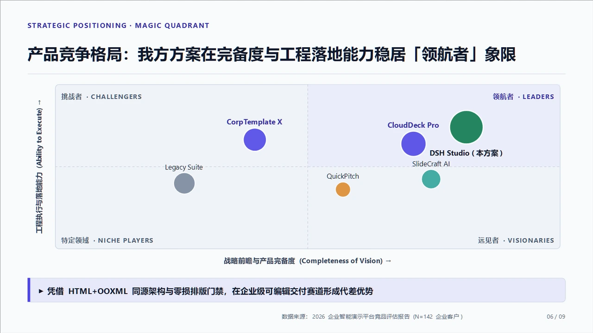
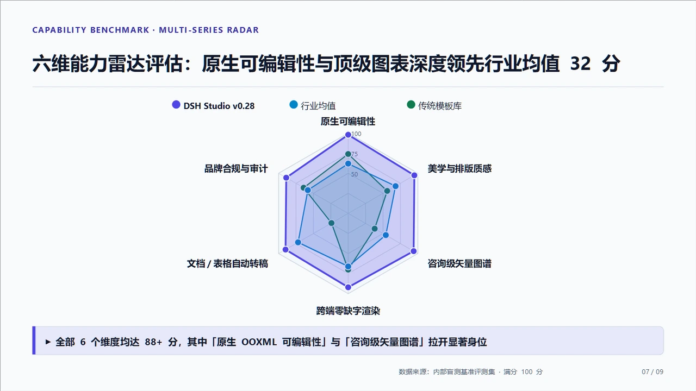

**简体中文** · [English](README.en.md)

# PPT

> **从文档、表格、流程图或旧 PPTX 出发，一键产出离线 HTML 放映稿与 100% 可编辑 PPTX。**

DeepSeek Harness（`>=0.2.2-rc.3`）大师级演示文稿引擎与 16:9 实体胶片灯箱工作台，覆盖三模路由研究、41 种双端同构原生图谱、企业品牌宪章锁与逆向 Office 配套交付。

[](https://www.npmjs.com/package/dsh-ppt) [](https://www.npmjs.com/package/dsh-ppt) [](https://www.npmjs.com/package/dsh-ppt)

**[核心能力](#核心能力) · [风格预览](#风格预览) · [安装](#安装) · [快速上手](#开始使用) · [完整说明](https://github.com/STARDUSTLC666/dsh-ppt/blob/master/docs/REFERENCE.zh.md)**

<picture>
  <source media="(prefers-color-scheme: dark) and (max-width: 640px)" srcset="https://raw.githubusercontent.com/STARDUSTLC666/dsh-ppt/master/docs/assets/intro/workflow-zh-mobile-dark.svg?v=0.36.0">
  <source media="(max-width: 640px)" srcset="https://raw.githubusercontent.com/STARDUSTLC666/dsh-ppt/master/docs/assets/intro/workflow-zh-mobile-light.svg?v=0.36.0">
  <source media="(prefers-color-scheme: dark)" srcset="https://raw.githubusercontent.com/STARDUSTLC666/dsh-ppt/master/docs/assets/intro/workflow-zh-dark.svg?v=0.36.0">
  
</picture>

## 核心能力

| 模块 | 核心特性 |
| :--- | :--- |
| **三模路由与权威深研** | **Mode A** 有资料直出 · **Mode B** 零资料 8 域权威深研（自动排除 25 站营销号）· **Mode C** 本地素材包融合外源对标，配合 `SLOP-13` 9 项信源分级门禁 |
| **41 种原生可编辑图谱** | HTML/SVG 与 PPTX OOXML 双端同构与中西文排印适配，内置 MECE 议题树、Treemap、OKR 子弹仪、报价矩阵、点阵地图、2.5D 等轴测、魔力象限、雷达、Mermaid（外圈回路避障）、公式与绝对行距防溢出代码窗 |
| **设计体系与零模型自修** | 13 个注册工具 · 内置三层「首席艺术总监」导演词与黄金字段速查 · 24 套主题（16 浅 8 深）· 6 套母版骨架 · 8 套品味配方 · 20 套标杆范本 · 61 枚原生矢量图标；落盘前 `SLOP-01..15` 零额外模型开销自检修复，支持整卡联动 PPTX 动效与单页切换 |
| **企业品牌锁与金页拼装** | `.dsh-ppt/brand-kit.json` 锁定色板、字体、Logo、页脚、保密水印与信源黑白名单（`SLOP-14`）；支持 `.dsh-ppt/slide-bank.json` 金页复用与跨工程拼装 |
| **全格式直吞与逆向导出** | 零新增依赖直吞 `.pdf`/`.docx`/`.xlsx`/`.csv`/`.pptx`/图片；按需逆向导出 `.xlsx`、`.docx`、高管质询预案、备忘录、一页纸、社媒长图、字幕与无损双语翻译包 |
| **实体灯箱工作台与联动** | 默认 16:9 发光胶片灯箱总览 + 单页精修画布（13 套风格 × 8 套字体）；联动 `dsh-cite` 核验文献、`dsh-remotion` 导出视频分镜，支持 `R` 键离线批注回流修订 |

<details>
<summary>展开查看：41 种图谱分类、多受众改编与现场演示快捷键速查</summary>

- **高管咨询与战略图谱**：MECE 议题树（`issue-tree`）、矩形树图（`treemap`）、OKR 子弹仪（`gauge`）、报价矩阵（`pricing`）、魔力象限（`quadrant`）、价值链、SWOT、哈维球与 TAM。
- **数据可视化与图表**：点阵地图（`map`）、2.5D 等轴测（`isometric`）、多维雷达（`radar`）、哑铃图（`dumbbell`）、热力图（`heatmap`）、桑基图、Marimekko、三线表与 13 类出版级图表。
- **工程与产品展示**：设备样机（`mockup`）、9 语言语法高亮代码窗（`code`）、原生 `<m:oMath>` 公式、Mermaid 连线、甘特图与系统架构图。
- **多受众一键改编（`remixPreset`）**：压缩为高管 5 分钟（6 页）/ 董事会（8 页）/ 客户路演（7 页）副本，折叠要点无损归档至备注；同步支持 `4:5` / `1:1` 社媒长图（`.carousel.html`）。
- **独立 HTML 现场演示快捷键**：`P` 双屏提词台 · `L` 虚拟激光笔 · `R` 离线批注导出 `review-feedback.json` · `D` 白板画笔 · `T` Q&A 倒计时 · `A` 自动字幕导览 · `Ctrl/Cmd+K` 全局速搜（含 `[E#]` 证据）。
- **模板吸收与高级检查**：支持 `ppt_absorb` 批量吸收本地 `.pptx` 沉淀审美 DNA，以及按需开启的数字溯源推演、24 页双层 AI 视觉审查与模拟答辩。

</details>

## 风格预览

以下画面均由 `dsh-ppt` 生成的 **100% 原生可编辑 `.pptx`** 经 LibreOffice 零缺字直接渲染，点击查看大图。

<table>
<tr>
  <th>发布会光晕海报封面（Keynote Glow）</th>
  <th>玻璃拟态 Bento + 原生矢量图标</th>
  <th>零依赖语法高亮代码窗（Code Split）</th>
</tr>
<tr>
  <td width="33%"><a href="https://raw.githubusercontent.com/STARDUSTLC666/dsh-ppt/master/assets/gallery/v28-cover-keynote-zh.webp"></a></td>
  <td width="33%"><a href="https://raw.githubusercontent.com/STARDUSTLC666/dsh-ppt/master/assets/gallery/v28-bento-glass-zh.webp"></a></td>
  <td width="33%"><a href="https://raw.githubusercontent.com/STARDUSTLC666/dsh-ppt/master/assets/gallery/v28-code-showcase-zh.webp"></a></td>
</tr>
<tr>
  <th>SaaS 浏览器原型展示（Device Mockup）</th>
  <th>战略魔力象限（Magic Quadrant）</th>
  <th>六维能力雷达评估（Multi-Series Radar）</th>
</tr>
<tr>
  <td width="33%"><a href="https://raw.githubusercontent.com/STARDUSTLC666/dsh-ppt/master/assets/gallery/v28-mockup-browser-zh.webp"></a></td>
  <td width="33%"><a href="https://raw.githubusercontent.com/STARDUSTLC666/dsh-ppt/master/assets/gallery/v28-quadrant-zh.webp"></a></td>
  <td width="33%"><a href="https://raw.githubusercontent.com/STARDUSTLC666/dsh-ppt/master/assets/gallery/v28-radar-zh.webp"></a></td>
</tr>
</table>

<details>
<summary>查看工作台界面（16:9 实体胶片灯箱与单页精修）</summary>


图片来自验证环境的真实界面或示例 PPTX 渲染，使用脱敏示例数据。

</details>

## 安装

在 DSH 桌面版「插件」面板安装 `dsh-ppt`，或使用命令行：

```bash
dsh plugin --profile desktop add dsh-ppt
```

网页版将 `desktop` 改为 `web`，安装后重启对应 DSH。宿主要求：`>=0.2.2-rc.3`。

## 开始使用

1. **快速起稿**：在左侧栏打开「演示文稿」（点 `? 引导` 可走 4 步导览），一键体验旗舰示例、选用 20 套行业蓝图、拖入 Office/旧 `.pptx`，或直接把文档与 Mermaid 发给对话助手。
2. **灯箱排片 → 单页精修**：打开工程默认进入 16:9 **灯箱总览**（拖拽或 `←/→` 调序、复制、插页）；单击任意胶片进入**单页精修**，双击画布原地改写、切换 41 种图谱并按 `Ctrl/⌘+S` 同步 HTML 与 PPTX。
3. **翻新与品牌沉淀**：支持导入外部 `.pptx` 一键翻新，或在 PowerPoint / WPS 修改后导回工作台（保留撤销历史）；可将公司模板吸收沉淀至「我的品牌库」。
4. **演练与全套交付**：按需开启 HTML + PPTX 并排对照、AI 叙事预审与模拟答辩；一键导出 PPTX、高管一页纸、Excel/Word/质询预案、社媒长图或 Remotion 视频分镜包。

### 常用对话示例

- **季度复盘**：`把这份材料整理成季度 OKR 复盘演示文稿，结论先行，用 KPI 卡片、价值链和痛点对比排版，输出 HTML 和可编辑 PPTX。`
- **套用公司模板**：`参考工作区里的 company-template.pptx 吸收配色、Logo 和母版骨架，把这份纪要做成正式汇报 PPT。`
- **产品路演**：`按明亮易读的投资备忘录风格把这份方案做成 10 页路演 PPT，包含 TAM 市场空间、竞品哈维球矩阵和甘特图。`

## 开始前要知道

- 成品可直接下载；AI 预审、模拟答辩与 24 页视觉审查均按需开启，默认不触发额外模型调用。
- CLI 与工具报错信息均为中文。
- 详细参数、工具清单与排错见 [完整说明](https://github.com/STARDUSTLC666/dsh-ppt/blob/master/docs/REFERENCE.zh.md)。

## 插件更新

在工作台或原生插件详情页底部检查更新。默认自动检查，**默认不自动安装**；Suite 管理的组件随整包更新。

## 文档与反馈

- [完整使用、配置与边界](https://github.com/STARDUSTLC666/dsh-ppt/blob/master/docs/REFERENCE.zh.md) · [更新记录](https://github.com/STARDUSTLC666/dsh-ppt/blob/master/CHANGELOG.md) · [验证范围与历史](https://github.com/STARDUSTLC666/dsh-ppt/blob/master/docs/VALIDATION.md)
- 欢迎 Star、提交 [Issues](https://github.com/STARDUSTLC666/dsh-ppt/issues) 与 [PR](https://github.com/STARDUSTLC666/dsh-ppt/pulls)（反馈请附版本与复现步骤，并移除凭据）。

## License

[MIT](https://github.com/STARDUSTLC666/dsh-ppt/blob/master/LICENSE)

<a id="依赖与配置"></a>
