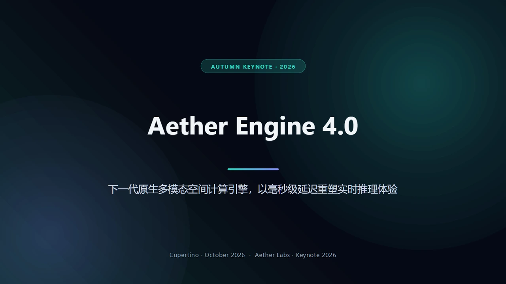
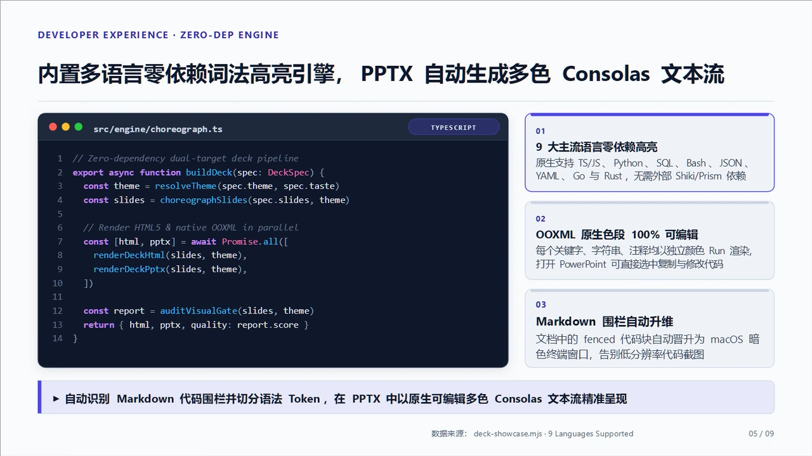
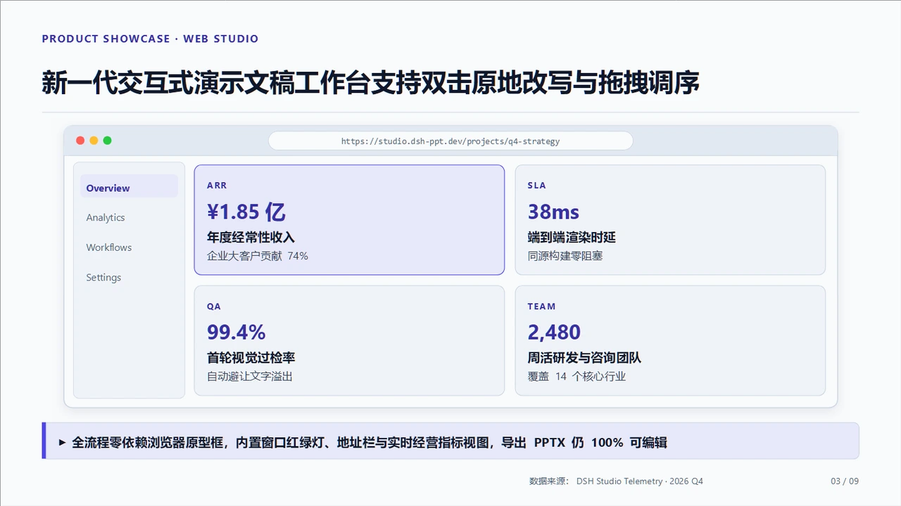

**简体中文** · [English](README.en.md)

# PPT

**在 DeepSeek Harness 中将材料整理为有审美品味、可直接交付的演示文稿，导出离线 HTML、可编辑 PPTX 与工程包，内置可切换五套明亮风格的工作台界面。**

[](https://www.npmjs.com/package/dsh-ppt) [](https://www.npmjs.com/package/dsh-ppt) [](https://www.npmjs.com/package/dsh-ppt)

**[安装使用](#安装) · [使用流程](#开始使用) · [完整说明](https://github.com/STARDUSTLC666/dsh-ppt/blob/master/docs/REFERENCE.zh.md)**

<picture>
  <source media="(prefers-color-scheme: dark) and (max-width: 640px)" srcset="https://raw.githubusercontent.com/STARDUSTLC666/dsh-ppt/master/docs/assets/intro/workflow-zh-mobile-dark.svg?v=0.28.0">
  <source media="(max-width: 640px)" srcset="https://raw.githubusercontent.com/STARDUSTLC666/dsh-ppt/master/docs/assets/intro/workflow-zh-mobile-light.svg?v=0.28.0">
  <source media="(prefers-color-scheme: dark)" srcset="https://raw.githubusercontent.com/STARDUSTLC666/dsh-ppt/master/docs/assets/intro/workflow-zh-dark.svg?v=0.28.0">
  
</picture>

## 功能

- **标杆范本槽位契约、批量优质 PPTX 投喂与弱模型升维引擎（0 额外模型调用）**：内置 **8 套满分标杆范本**（`mckinsey-strategy` / `sequoia-pitch` / `stripe-product-launch` / `quarterly-exec-review` / `tech-arch-rfc` / `academic-defense` / `enterprise-proposal` / `gov-institutional`），通过 `ppt_templates({ exemplarId })` 暴露逐页槽位填空契约；支持 `ppt_absorb` / `--ingest-exemplars <dir>` 离线批量吸收 GitHub 或企业优质 `.pptx` 目录沉淀至 `.dsh-ppt/exemplars.json`；内置 **确定性弱模型补偿器（`autoUpgrade`）**，即使输入粗糙纯要点墙也能 100% 无损自动晋升 `kpi[spotlight]` / `dumbbell` / `radar` / `quadrant` / `heatmap` / `code[split]` / `mockup`，自动拆分 `>6` 条长要点、提炼结论标题并补全可执行封底。
- **大师审美工坊（8 套品味配方 + 61 枚原生矢量图标 + 封面主图分屏与几何肌理）**：内置 **8 套大师级 Taste Recipes**（`mckinsey-partner`、`apple-keynote-dark`、`apple-keynote-light`、`swiss-editorial`、`linear-craft`、`ft-data-journal`、`nature-academic`、`oriental-zen`），一键驱动 **4 套海报级封面**（径向光晕 `keynote-glow` / 瑞士网格 `editorial-grid` / 建筑深色侧翼 `architectural` / `split-bleed`）、**Hero Photo Split 全出血主图分屏封面** 与 **程序化几何肌理**（`coverPattern: 'dots' | 'grid' | 'rings'`）、**`section[agenda]` 实时章节进度页**、**4 种卡片材质**（`solid` / `frameless` / `glass` / `editorial-rule`）、**反单调主次构图**（`kpi[spotlight]` / `cards[bento-hero]`）、**61 枚零依赖原生矢量图标**（HTML `<svg>` + PPTX 原生 `<a:custGeom>`）及出版级图表精修；上传任意优秀 `.pptx` 还可提取 6 维深层审美 DNA（`styleRecipe`）持久化复用。
- **科技产品展示 & 35+ 原生可编辑商业分析图谱**：自动匹配 **24 套大师主题**、**6 套差异化母版骨架** 与 **20 套行业蓝图**，新增原生矢量 **设备原型展示 `mockup`**（`browser` / `mobile` 灵动岛 / `split`，支持截图嵌入与内置 UI 卡片）、**9 语言零依赖语法高亮代码窗 `code`**（自动晋升 Markdown ```` ```lang ```` 代码块，PPTX 生成多色可编辑 Consolas 文本流），以及 **四大顶级商业分析矢量图谱**：**魔力象限 `quadrant`**、**多维雷达图 `radar`**、**麦肯锡哑铃跃迁图 `dumbbell`** 与 **WCAG 自适应热力矩阵 `heatmap`**；同时涵盖原生 `<m:oMath>` 数学公式、Mermaid 流程图/时序图直转原生吸附连线、不等宽市场图 `marimekko`、多层桑基图 `sankey`、波特价值链、SWOT、甘特图、分层架构、哈维球、TAM 同心圆、三线表与 13 种出版级图表。
- **全格式直吞与生态联动（Word / Excel / CSV / PPTX / Cite / Remotion）**：`ppt_from_office` 零外部依赖直吞 **`.xlsx` 多工作表 / `.csv` / `.tsv` 与 `.docx` Word 报告**；`ppt_import` 支持外部 `.pptx` 一键翻新与 Office 双向导回（≤24 MiB 内存解析，保留撤销历史）；`ppt_cite` 联动 **`dsh-cite`** 生成核验参考文献页，`ppt_remotion` 导出 **`dsh-remotion`** 动画视频分镜包。
- **直接操纵工作台与一键全格式导出**：适配 DeepSeek Harness `>=0.2.2-rc.3`，内置多套明亮风格与字体切换；支持左侧目录 **拖拽排序（Drag-and-Drop）**、画布 **双击文字原地改写并原子同步 PPTX**、右上角 **`? 引导`** 交互导览、**「一键体验旗舰示例」** 与 **演讲时长预算器**；导出面板支持 **最新 PPTX**、**高精 PDF（`.pdf`）**、**逐页 PNG 图包（`.zip`）**、**高管一页纸（`.onepager.html`）**、**Remotion 分镜包（`.zip`）**、**讲义（`.handout.md`）** 与独立 HTML **`P` 键双屏提词台 + `L` 键虚拟激光笔**。
- **可选高阶能力**：数字溯源与现场推演、24 页双层 AI 视觉审查（含 12 种无损排版修复与全宽前后对比）、高管叙事预审与模拟答辩。

## 风格预览

以下画面均由 `dsh-ppt` 生成的 **100% 原生可编辑 `.pptx`** 经 LibreOffice 零缺字直接渲染。点击查看大图。

<table>
<tr>
  <th>发布会光晕海报封面（Keynote Glow）</th>
  <th>玻璃拟态 Bento + 原生矢量图标</th>
  <th>零依赖语法高亮代码窗（Code Split）</th>
</tr>
<tr>
  <td width="33%"><a href="https://raw.githubusercontent.com/STARDUSTLC666/dsh-ppt/master/assets/gallery/v28-cover-keynote-zh.webp"></a></td>
  <td width="33%"><a href="https://raw.githubusercontent.com/STARDUSTLC666/dsh-ppt/master/assets/gallery/v28-bento-glass-zh.webp"></a></td>
  <td width="33%"><a href="https://raw.githubusercontent.com/STARDUSTLC666/dsh-ppt/master/assets/gallery/v28-code-showcase-zh.webp"></a></td>
</tr>
<tr>
  <th>SaaS 浏览器原型展示（Device Mockup）</th>
  <th>战略魔力象限（Magic Quadrant）</th>
  <th>六维能力雷达评估（Multi-Series Radar）</th>
</tr>
<tr>
  <td width="33%"><a href="https://raw.githubusercontent.com/STARDUSTLC666/dsh-ppt/master/assets/gallery/v28-mockup-browser-zh.webp"></a></td>
  <td width="33%"><a href="https://raw.githubusercontent.com/STARDUSTLC666/dsh-ppt/master/assets/gallery/v28-quadrant-zh.webp"></a></td>
  <td width="33%"><a href="https://raw.githubusercontent.com/STARDUSTLC666/dsh-ppt/master/assets/gallery/v28-radar-zh.webp"></a></td>
</tr>
</table>

以上画面均由原生可编辑 PPTX 经 LibreOffice 渲染生成，使用示例脱敏数据。

<details>
<summary>查看工作台界面</summary>


图片来自验证环境的真实界面或示例 PPTX 渲染，使用示例数据。

</details>

## 安装

在 DSH 桌面版「插件」面板安装 `dsh-ppt`。已配置命令行时也可使用：

```bash
dsh plugin --profile desktop add dsh-ppt
```

网页版把 `desktop` 改为 `web`；安装后重启对应的 DSH。宿主要求以包声明 `>=0.2.2-rc.3` 为准。

## 开始使用

符合直觉的四步工作流（无需记参数，对话或工作台均可直接起步）：

1. **快速起稿（三选一）**：
   - **直接在面板起稿或一键体验**：从左侧栏打开「演示文稿」（可随时点顶部 **`? 引导`** 启动四步导览），点击 **「一键体验旗舰示例」** 零延迟预览旗舰版式，或点击 **「新建演示文稿」** 从 20 套行业蓝图起步，或拖入 **`.xlsx` / `.csv` / `.docx` / `.pptx`** 直接建稿。
   - **在对话中交给助手**：把 Word、Excel/CSV、Markdown（含 ```` ```mermaid ```` 流程图/时序图）或参考 `.pptx` 发给助手，自动导演会按听众匹配明亮投影风与多版式节奏，并可调用 `ppt_cite` 关联 `dsh-cite` 真实文献。
2. **点哪改哪 & 换版式与时长预算**：在「内容编辑」直接点击预览画面里的标题、卡片或表格即可定位到右侧编辑框；顶部可一键切换 **Mermaid 流程图/时序图、KPI 大数字、不等宽市场图（Marimekko）、桑基流向图（Sankey）、波特价值链、SWOT 矩阵、甘特图、系统架构图、哈维球矩阵或学术三线表**（并支持 LaTeX 原生公式），设置 **目标演讲时长（分钟）** 实时检查每页超时风险，改完按 `Ctrl/⌘+S` 或点击「保存此页」同步更新 HTML 与 PPTX。
3. **导入翻新、Office 导回与品牌沉淀**：支持点击「**导入 PPTX 翻新**」或「**导入 Word/Excel**」直接重塑现有文件，或在 PowerPoint / WPS 微调后通过「**导入 Office 修改稿**」同步回工作台（保留撤销历史）；也可在「风格与母版」一键套用 8 套名家范本或收藏公司模板到「我的品牌库」。
4. **双屏演讲、一页纸与视频分镜交付**：需要精检排版时点「渲染当前 PPTX」开启 **HTML + PPTX 并排对比**（或按需开启 AI 叙事预审、模拟答辩与 24 页视觉看图修复）；放映 HTML 时按 `P` 开启双屏提词台、按 `L` 使用虚拟激光笔，并在下载菜单一键导出最新 PPTX、**高管一页纸（`.onepager.html`）**、**Remotion 视频分镜包（`.zip`）**、**演讲讲义（`.md`）** 或分享包 ZIP。

常用对话指令示例（可直接复制告诉助手）：

- **日常汇报 / OKR 复盘**：`请把这份材料整理成季度 OKR 复盘演示文稿，结论先行，用 KPI 卡片、价值链箭头和痛点对比排版，生成 HTML 和可编辑 PPTX。`
- **吸收公司模板做新稿**：`参考工作区里的 company-template.pptx 吸收配色、Logo、母版骨架与版式节奏，把这份纪要做成一套可直接投影的正式汇报 PPT。`
- **产品方案 / 融资路演**：`按明亮易读的投资备忘录风格把这份产品方案做成 10 页路演 PPT，包含 TAM 市场空间、竞品哈维球矩阵和里程碑甘特图。`

## 开始前要知道

可直接下载成品；AI 预审、模拟答辩与看图修复均按需开启。支持导入外部 PPTX 一键翻新，或在 Office 微调后导回工作台更新工程；内置按 P 开启双屏演讲者提词台与讲义导出。

配置、完整工具与排错见[详细使用说明](https://github.com/STARDUSTLC666/dsh-ppt/blob/master/docs/REFERENCE.zh.md)。

## 插件更新

在工作台或原生插件详情页底部检查更新。默认自动检查，**默认不自动安装**；是否安装、何时重启由你决定。Suite 管理的组件随整包更新。[查看更新规则](https://github.com/STARDUSTLC666/dsh-ppt/blob/master/docs/REFERENCE.zh.md)。

## 文档

- [详细使用、配置与边界](https://github.com/STARDUSTLC666/dsh-ppt/blob/master/docs/REFERENCE.zh.md)
- [更新记录](https://github.com/STARDUSTLC666/dsh-ppt/blob/master/CHANGELOG.md)
- [验证范围与历史](https://github.com/STARDUSTLC666/dsh-ppt/blob/master/docs/VALIDATION.md)

## 反馈与贡献

如果插件帮到了你，欢迎 Star，让更多人发现它。问题和建议请提交 [Issues](https://github.com/STARDUSTLC666/dsh-ppt/issues)，也欢迎代码与文档 [PR](https://github.com/STARDUSTLC666/dsh-ppt/pulls)。反馈时附上版本与复现步骤，并移除凭据。

## License

[MIT](https://github.com/STARDUSTLC666/dsh-ppt/blob/master/LICENSE)

<a id="依赖与配置"></a>
