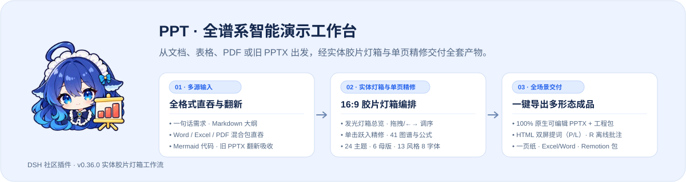
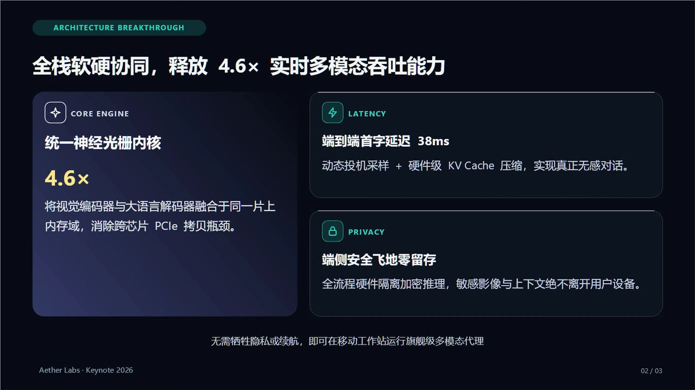
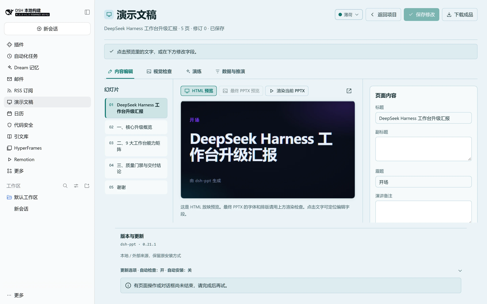

**简体中文** · [English](README.en.md)

# PPT

**DeepSeek Harness 大师级演示文稿引擎与工作台：支持三模路由（有资料直出 / 零资料 8 域权威深研 / Mode C 本地多源融合+外源对标）、企业品牌宪章锁与 SLOP-13/14 双重合规门禁、41 种原生可编辑图谱（MECE 议题树/Treemap/OKR 子弹仪/三档报价/点阵地图/2.5D 等轴测/Mermaid/公式/代码）、20 套标杆范本、24 主题、逆向导出 Excel/Word/备忘录/答辩预案/无损翻译包、企业金页拼装与离线 R 键审阅回流，一键导出离线 HTML 放映与 100% 可编辑 PPTX。**

[](https://www.npmjs.com/package/dsh-ppt) [](https://www.npmjs.com/package/dsh-ppt) [](https://www.npmjs.com/package/dsh-ppt)

**[安装使用](#安装) · [使用流程](#开始使用) · [完整说明](https://github.com/STARDUSTLC666/dsh-ppt/blob/master/docs/REFERENCE.zh.md)**

<picture>
  <source media="(prefers-color-scheme: dark) and (max-width: 640px)" srcset="https://raw.githubusercontent.com/STARDUSTLC666/dsh-ppt/master/docs/assets/intro/workflow-zh-mobile-dark.svg?v=0.28.0">
  <source media="(max-width: 640px)" srcset="https://raw.githubusercontent.com/STARDUSTLC666/dsh-ppt/master/docs/assets/intro/workflow-zh-mobile-light.svg?v=0.28.0">
  <source media="(prefers-color-scheme: dark)" srcset="https://raw.githubusercontent.com/STARDUSTLC666/dsh-ppt/master/docs/assets/intro/workflow-zh-dark.svg?v=0.28.0">
  
</picture>

## 功能

- **三模路由、8 大领域权威信源引擎与 Mode C 混合深研（`SLOP-13` 升级 9 项）**：支持 **Mode A（有资料直出）**、**Mode B（零资料 8 域权威深研：`site:` + `filetype:pdf` + `-site:` 排除 25 站营销号）** 与 **Mode C（本地混合素材包 × 权威外源对标）**；`ppt_from_office({ inspectOnly: true })` 低 Token 返回精炼 **Material Dossier** 与 **`enrichmentPlan`**（自动编目本地 `E1..Ek` 并顺延外部起始编号），支持 `instructions` 自然语言编排、`maxSlides`、`includeSheets`、`photoRoles`、`bindDataModel: true`（Excel 实时绑定 `dataModel`）与人像自动 `focalPoint: 'top'` 防切头；代码级 `classifySourceAuthority`（T1/T2/T3）与 `SLOP-13` 9 项门禁拦截二手转引、低权威自媒体、未标注预测口径、缺年份及过时外部基准，工作区 `.dsh-ppt/brand-kit.json` 同步支持 `preferredSources` 与 `blockedDomains`。
- **41 种原生可编辑图谱（36 核心 + 5 媒体，含 53 别名）与 4 套高管咨询新图**：零新增依赖、HTML/SVG 与 PPTX 原生 OOXML 双端同构——新增 **麦肯锡 MECE 逻辑议题树 `issue-tree`**、**比例面积矩形树图 `treemap`**、**Stephen Few OKR 水平子弹仪 `gauge`** 与 **三档商业报价矩阵 `pricing`**（并支持 HTML CSS 按需 Tree-Shaking），叠加 **全球/中国点阵地图 `map`**、**2.5D 等轴测堆叠/柱碑 `isometric`**、**魔力象限 `quadrant`**、**多维雷达 `radar`**、**哑铃跃迁 `dumbbell`**、**热力图 `heatmap`**、**设备样机 `mockup`**、**9 语言语法高亮代码窗 `code`**、原生 `<m:oMath>` 公式、Mermaid 原生吸附连线、Marimekko、桑基图、波特价值链、SWOT、甘特图、系统架构、哈维球、TAM、组织图谱、学术三线表与 **13 类出版级图表**。
- **逆向 Office 配套导出、企业金页拼装、100% 无损翻译与离线 `R` 键审阅闭环**：零新增依赖通过 `exports[]`（CLI `--export`）按需配套导出 **`.xlsx` Excel 数据工作簿**、**`.docx` Word 汇报文档**、**`.qa-prep.md` 会前高管质询预案**、**`.memo.md` 高管备忘录** 与 **`.i18n.json` 翻译槽位包**（工作台同步支持下载 `.xlsx`/`.docx`/`.qa-prep.md`）；支持 **企业金页库 `.dsh-ppt/slide-bank.json`（`saveToBank`）+ 跨工程拼装（`mergeSources`）**（SHA-256 图片去重 + 跨工程 `[E#]` 无冲突重映射）、**100% 版式无损翻译与中英双语化（`translations` / `bilingualMode`）**、单页分步点击显现 **`reveal: 'step'`** 与 **`motionProfile`**，以及独立 HTML 按 **`R` 键离线批注导出 `review-feedback.json`** → `ppt_check({ feedbackPath })` 回流 AI 逐页修订。
- **企业品牌宪章锁（`SLOP-14`）、多受众改编、社媒长图与现场演示增强包**：支持将企业色板、字体、Logo、统一页脚、内容页保密水印（`CONFIDENTIAL · 内部资料`，HTML/PPTX 同构）、官方封底及权威信源名单锁存至 `.dsh-ppt/brand-kit.json`；`ppt_edit({ remixPreset })` / `--remix` 一键压缩改编为 **高管 5 分钟（6 页）** / **董事会（8 页）** / **客户路演（7 页）**副本（被折叠要点无损归档备注）并导出 **4:5 / 1:1 社媒长图卡片（`.carousel.html`）**；独立 HTML 内置 **`Ctrl/Cmd+K` 全局速搜（含 `[E#]` 证据）**、**`R` 键审阅批注**、**`D` 键白板画笔**、**`T` 键 Q&A 倒计时**、**`A` 键自动字幕导览**、**`P` 键双屏提词台**、**`L` 键虚拟激光笔** 与 **`.srt`/`.vtt` 字幕导出**（同步内置于 `dsh-remotion`）。
- **20 套标杆范本槽位契约（含 12 套 GitHub 开源实机蒸馏）、8 套品味配方与零模型自检修复闭环**：内置 **13 个注册工具**、**24 套大师主题（16 浅 8 深）**、**6 套母版骨架**、**8 套大师 Taste Recipes**、**20 套行业蓝图**、**20 套标杆范本**（支持 `exemplar: "auto"`、`alignOrder: true` 与 Few-Shot JSON 样板）与 **61 枚原生 `<a:custGeom>` 矢量图标**；支持 `ppt_absorb` / `--ingest-exemplars` 批量吸收本地 `.pptx` 目录沉淀审美 DNA 与范本；内置 **确定性弱模型补偿器 + 落盘前 `SLOP-01..14` 零模型自检修复闭环**，0 额外模型开销直出零告警成品。
- **全格式直吞、直接操纵工作台与生态联动**：`ppt_from_office` 零新增依赖直吞 `.pdf`/`.docx`/`.xlsx`/`.csv`/`.tsv`/`.png`/`.jpg`/`.webp` 混合素材包；`ppt_import` 支持外部 `.pptx` 一键翻新与 Office 双向导回（保留撤销历史）；`ppt_cite` 联动 `dsh-cite` 核验文献，`ppt_remotion` 导出 `dsh-remotion` 视频分镜包；工作台（适配 DSH `>=0.2.2-rc.3`）支持左侧拖拽排序、画布双击原地改写、证据账本与修订差异抽屉、一键导出 PPTX / PDF / PNG 图包 / Excel / Word / 质询预案 / 一页纸 / 社媒长图 / 字幕，以及按需开启的 **数字溯源推演、24 页双层 AI 视觉审查与模拟答辩**。

## 风格预览

以下画面均由 `dsh-ppt` 生成的 **100% 原生可编辑 `.pptx`** 经 LibreOffice 零缺字直接渲染。点击查看大图。

<table>
<tr>
  <th>发布会光晕海报封面（Keynote Glow）</th>
  <th>玻璃拟态 Bento + 原生矢量图标</th>
  <th>零依赖语法高亮代码窗（Code Split）</th>
</tr>
<tr>
  <td width="33%"><a href="https://raw.githubusercontent.com/STARDUSTLC666/dsh-ppt/master/assets/gallery/v28-cover-keynote-zh.webp"></a></td>
  <td width="33%"><a href="https://raw.githubusercontent.com/STARDUSTLC666/dsh-ppt/master/assets/gallery/v28-bento-glass-zh.webp"></a></td>
  <td width="33%"><a href="https://raw.githubusercontent.com/STARDUSTLC666/dsh-ppt/master/assets/gallery/v28-code-showcase-zh.webp"></a></td>
</tr>
<tr>
  <th>SaaS 浏览器原型展示（Device Mockup）</th>
  <th>战略魔力象限（Magic Quadrant）</th>
  <th>六维能力雷达评估（Multi-Series Radar）</th>
</tr>
<tr>
  <td width="33%"><a href="https://raw.githubusercontent.com/STARDUSTLC666/dsh-ppt/master/assets/gallery/v28-mockup-browser-zh.webp"></a></td>
  <td width="33%"><a href="https://raw.githubusercontent.com/STARDUSTLC666/dsh-ppt/master/assets/gallery/v28-quadrant-zh.webp"></a></td>
  <td width="33%"><a href="https://raw.githubusercontent.com/STARDUSTLC666/dsh-ppt/master/assets/gallery/v28-radar-zh.webp"></a></td>
</tr>
</table>

以上画面均由原生可编辑 PPTX 经 LibreOffice 渲染生成，使用示例脱敏数据。

<details>
<summary>查看工作台界面</summary>



图片来自验证环境的真实界面或示例 PPTX 渲染，使用示例数据。

</details>

## 安装

在 DSH 桌面版「插件」面板安装 `dsh-ppt`。已配置命令行时也可使用：

```bash
dsh plugin --profile desktop add dsh-ppt
```

网页版把 `desktop` 改为 `web`；安装后重启对应的 DSH。宿主要求以包声明 `>=0.2.2-rc.3` 为准。

## 开始使用

符合直觉的四步工作流（无需记参数，对话或工作台均可直接起步）：

1. **快速起稿（三选一）**：
   - **直接在面板起稿或一键体验**：从左侧栏打开「演示文稿」（可随时点顶部 **`? 引导`** 启动四步导览），点击 **「一键体验旗舰示例」** 零延迟预览旗舰版式，或点击 **「新建演示文稿」** 从 20 套行业蓝图起步，或拖入 **`.xlsx` / `.csv` / `.docx` / `.pptx`** 直接建稿。
   - **在对话中交给助手**：把 Word、Excel/CSV、Markdown（含 ```` ```mermaid ```` 流程图/时序图）或参考 `.pptx` 发给助手，自动导演会按听众匹配明亮投影风与多版式节奏，并可调用 `ppt_cite` 关联 `dsh-cite` 真实文献。
2. **点哪改哪 & 换版式与时长预算**：在「内容编辑」直接点击预览画面里的标题、卡片或表格即可定位到右侧编辑框；顶部可一键切换 **Mermaid 流程图/时序图、KPI 大数字、不等宽市场图（Marimekko）、桑基流向图（Sankey）、波特价值链、SWOT 矩阵、甘特图、系统架构图、哈维球矩阵或学术三线表**（并支持 LaTeX 原生公式），设置 **目标演讲时长（分钟）** 实时检查每页超时风险，改完按 `Ctrl/⌘+S` 或点击「保存此页」同步更新 HTML 与 PPTX。
3. **导入翻新、Office 导回与品牌沉淀**：支持点击「**导入 PPTX 翻新**」或「**导入 Word/Excel**」直接重塑现有文件，或在 PowerPoint / WPS 微调后通过「**导入 Office 修改稿**」同步回工作台（保留撤销历史）；也可在「风格与母版」一键套用 8 套名家范本或收藏公司模板到「我的品牌库」。
4. **双屏演讲、一页纸与视频分镜交付**：需要精检排版时点「渲染当前 PPTX」开启 **HTML + PPTX 并排对比**（或按需开启 AI 叙事预审、模拟答辩与 24 页视觉看图修复）；放映 HTML 时按 `P` 开启双屏提词台、按 `L` 使用虚拟激光笔，并在下载菜单一键导出最新 PPTX、**高管一页纸（`.onepager.html`）**、**Remotion 视频分镜包（`.zip`）**、**演讲讲义（`.md`）** 或分享包 ZIP。

常用对话指令示例（可直接复制告诉助手）：

- **日常汇报 / OKR 复盘**：`请把这份材料整理成季度 OKR 复盘演示文稿，结论先行，用 KPI 卡片、价值链箭头和痛点对比排版，生成 HTML 和可编辑 PPTX。`
- **吸收公司模板做新稿**：`参考工作区里的 company-template.pptx 吸收配色、Logo、母版骨架与版式节奏，把这份纪要做成一套可直接投影的正式汇报 PPT。`
- **产品方案 / 融资路演**：`按明亮易读的投资备忘录风格把这份产品方案做成 10 页路演 PPT，包含 TAM 市场空间、竞品哈维球矩阵和里程碑甘特图。`

## 开始前要知道

可直接下载成品；AI 预审、模拟答辩与看图修复均按需开启。CLI 与工具报错信息均为中文。支持导入外部 PPTX 一键翻新，或在 Office 微调后导回工作台更新工程；独立 HTML 内置按 `P` 开启双屏演讲者提词台、按 `R` 离线批注导出 `review-feedback.json` 给 AI 修订，并支持配套导出 `.xlsx` / `.docx` / `.qa-prep.md` / `.handout.md`。

配置、完整工具与排错见[详细使用说明](https://github.com/STARDUSTLC666/dsh-ppt/blob/master/docs/REFERENCE.zh.md)。

## 插件更新

在工作台或原生插件详情页底部检查更新。默认自动检查，**默认不自动安装**；是否安装、何时重启由你决定。Suite 管理的组件随整包更新。[查看更新规则](https://github.com/STARDUSTLC666/dsh-ppt/blob/master/docs/REFERENCE.zh.md)。

## 文档

- [详细使用、配置与边界](https://github.com/STARDUSTLC666/dsh-ppt/blob/master/docs/REFERENCE.zh.md)
- [更新记录](https://github.com/STARDUSTLC666/dsh-ppt/blob/master/CHANGELOG.md)
- [验证范围与历史](https://github.com/STARDUSTLC666/dsh-ppt/blob/master/docs/VALIDATION.md)

## 反馈与贡献

如果插件帮到了你，欢迎 Star，让更多人发现它。问题和建议请提交 [Issues](https://github.com/STARDUSTLC666/dsh-ppt/issues)，也欢迎代码与文档 [PR](https://github.com/STARDUSTLC666/dsh-ppt/pulls)。反馈时附上版本与复现步骤，并移除凭据。

## License

[MIT](https://github.com/STARDUSTLC666/dsh-ppt/blob/master/LICENSE)

<a id="依赖与配置"></a>
