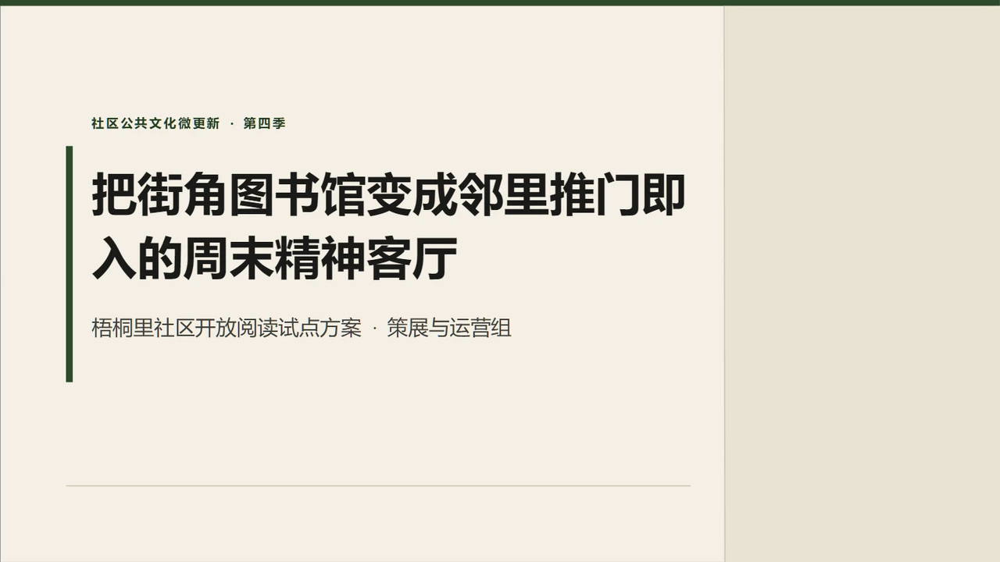
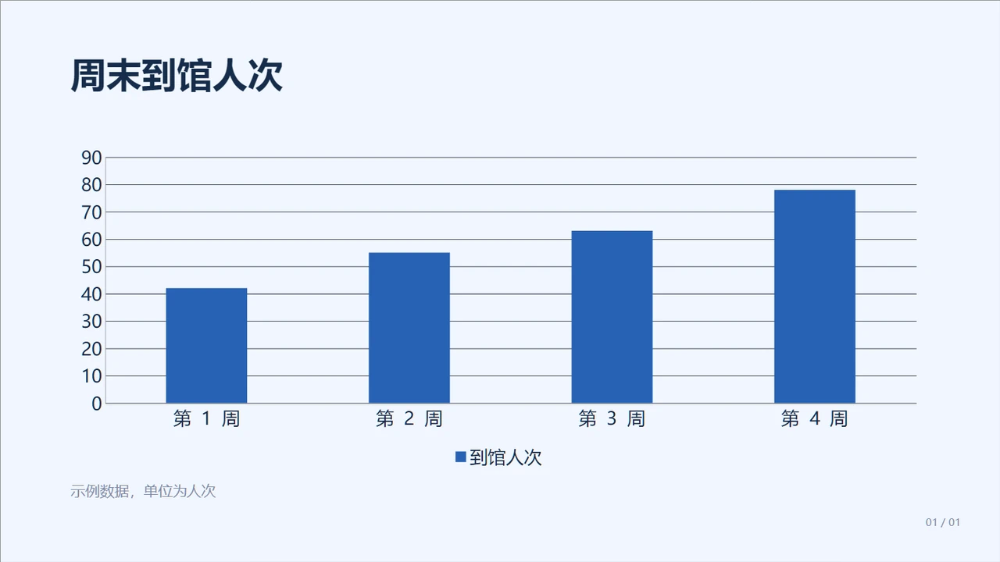

**简体中文** · [English](README.en.md)

# PPT

**在 DeepSeek Harness 中将材料整理为有审美品味、可直接交付的演示文稿，导出离线 HTML、可编辑 PPTX 与工程包，内置可切换五套明亮风格的工作台界面。**

[](https://www.npmjs.com/package/dsh-ppt) [](https://www.npmjs.com/package/dsh-ppt) [](https://www.npmjs.com/package/dsh-ppt)

**[安装使用](#安装) · [使用流程](#开始使用) · [完整说明](https://github.com/STARDUSTLC666/dsh-ppt/blob/master/docs/REFERENCE.zh.md)**

<picture>
  <source media="(prefers-color-scheme: dark) and (max-width: 640px)" srcset="https://raw.githubusercontent.com/STARDUSTLC666/dsh-ppt/master/docs/assets/intro/workflow-zh-mobile-dark.svg">
  <source media="(max-width: 640px)" srcset="https://raw.githubusercontent.com/STARDUSTLC666/dsh-ppt/master/docs/assets/intro/workflow-zh-mobile-light.svg">
  <source media="(prefers-color-scheme: dark)" srcset="https://raw.githubusercontent.com/STARDUSTLC666/dsh-ppt/master/docs/assets/intro/workflow-zh-dark.svg">
  
</picture>

## 功能

- **零品味负担自动导演**：无需懂排版配色，一句话或文档自动匹配 **18 套大师主题**（12 套明亮投影友好 + 6 套沉浸深色）与 **6 套差异化母版骨架**（麦肯锡直角 / Apple 空间留白 / 杂志社论书脊 / 黑曜石 Bento / 学术 Beamer 通栏页眉 / 东方政务双线），覆盖 **16 套行业场景蓝图** 与 **24 种原生可编辑版式与专业图示**（Bento 网格、KPI 大数字、2×2 矩阵、痛点对比、飞轮/漏斗流程、甘特图路线图、分层系统架构、哈维球竞品矩阵、TAM/SAM/SOM 同心圆、组织/团队图谱、学术三线表、13 种出版级图表与矢量瀑布桥）。
- **深度吸收外部 `.pptx`**：既内建麦肯锡 / 经济学人 / 现代政务 / 清澄学术 / Apple / 金融时报规范，也支持通过 `ppt_absorb`、`referencePptx`（`cloneStructure: true`）或工作台拖拽外部 `.pptx` 解析 OOXML 修饰色板、字体、Logo、母版骨架几何（`extractedSkeleton` / `recommendedChrome`）与逐页版式序列（`slideSkeleton`），自带 WCAG 对比度净化与刺眼红底降级。
- **工作台轻量精修**：适配 DeepSeek Harness `>=0.2.2-rc.3`，工作台与弹窗支持「原生清透 / 米白纸感 / Claude 暖书卷 / 8-Bit 像素 / 晴空薄荷」五套明亮主题切换；在「风格与母版」一键切换 18 套演示主题、6 套母版骨架或拖拽吸收 `.pptx`，在「内容编辑」一键切换 24 种版式、编辑甘特图/哈维球/卡片/三线表与单页骨架，支持 HTML ↔ PPTX 并排对比与撤销。
- **可选高阶能力**：数字溯源与现场推演（支持卡片/甘特图/TAM/哈维球/架构绑定）、24 页双层 AI 视觉审查（含 12 种无损排版修复与全宽前后对比）、高管叙事预审与模拟答辩。

## 风格预览

这些画面来自插件生成的 PPTX。点击查看大图。

<table>
<tr>
  <th>森系社论封面</th>
  <th>暖调精装图文页</th>
  <th>焦点高亮数据页</th>
</tr>
<tr>
  <td width="33%"><a href="https://raw.githubusercontent.com/STARDUSTLC666/dsh-ppt/master/assets/gallery/editorial-zh.webp"></a></td>
  <td width="33%"><a href="https://raw.githubusercontent.com/STARDUSTLC666/dsh-ppt/master/assets/gallery/reading-corner-zh.webp"></a></td>
  <td width="33%"><a href="https://raw.githubusercontent.com/STARDUSTLC666/dsh-ppt/master/assets/gallery/visits-chart-zh.webp"></a></td>
</tr>
</table>

图文页用了生成配图，图表用的是示例数据。

<details>
<summary>查看工作台界面</summary>


图片来自验证环境的真实界面或示例 PPTX 渲染，使用示例数据。

</details>

## 安装

在 DSH 桌面版「插件」面板安装 `dsh-ppt`。已配置命令行时也可使用：

```bash
dsh plugin --profile desktop add dsh-ppt
```

网页版把 `desktop` 改为 `web`；安装后重启对应的 DSH。宿主要求以包声明 `>=0.2.2-rc.3` 为准。

## 开始使用

1. 在目标工作区直接提供材料、用途或外部参考 `.pptx`（无需手调设计参数，自动导演会按汇报、答辩、路演或政务场景匹配明亮高质感风格与多版式节奏）。
2. 从左侧栏打开“演示文稿”，在工程库搜索或选择生成的项目。
3. 在「内容编辑」一键切换 24 种版式、编辑甘特图/哈维球/卡片/表格/图片或新增页面；在「风格与母版」一键切换 18 套主题、6 套母版骨架或拖拽 `.pptx` 吸收配色、骨架与 Logo；需要时渲染当前 PPTX 并排对比画面。
4. 按需要主动开启 AI 叙事预审、模拟答辩或看图修复（最多 24 页）；直接下载成品不要求这些步骤。
5. 下载“分享成品包”交付，或下载“完整工程包”保留编辑能力；在目标播放器或 Office 中再核对一次。

可以这样说：

> 根据这些材料制作季度汇报演示文稿，自动匹配商务明亮风格与多版式卡片/图表，生成 HTML、可编辑 PPTX 和工程包。

## 开始前要知道

可直接下载成品；AI 预审、模拟答辩与看图修复均按需开启。Office 中的手工修改不会自动同步回 JSON 工程。

配置、完整工具与排错见[详细使用说明](https://github.com/STARDUSTLC666/dsh-ppt/blob/master/docs/REFERENCE.zh.md)。

## 插件更新

在工作台或原生插件详情页底部检查更新。默认自动检查，**默认不自动安装**；是否安装、何时重启由你决定。Suite 管理的组件随整包更新。[查看更新规则](https://github.com/STARDUSTLC666/dsh-ppt/blob/master/docs/REFERENCE.zh.md)。

## 文档

- [详细使用、配置与边界](https://github.com/STARDUSTLC666/dsh-ppt/blob/master/docs/REFERENCE.zh.md)
- [更新记录](https://github.com/STARDUSTLC666/dsh-ppt/blob/master/CHANGELOG.md)
- [验证范围与历史](https://github.com/STARDUSTLC666/dsh-ppt/blob/master/docs/VALIDATION.md)

## 反馈与贡献

如果插件帮到了你，欢迎 Star，让更多人发现它。问题和建议请提交 [Issues](https://github.com/STARDUSTLC666/dsh-ppt/issues)，也欢迎代码与文档 [PR](https://github.com/STARDUSTLC666/dsh-ppt/pulls)。反馈时附上版本与复现步骤，并移除凭据。

## License

[MIT](https://github.com/STARDUSTLC666/dsh-ppt/blob/master/LICENSE)

<a id="依赖与配置"></a>
